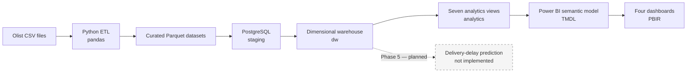

# E-Commerce Data Intelligence Platform

> End-to-End Data Engineering, Analytics, Business Intelligence & Machine Learning.

This portfolio project turns the public Brazilian Olist e-commerce dataset into a documented analytics platform: raw CSV files are profiled, transformed into typed Parquet datasets, loaded into a PostgreSQL dimensional warehouse, exposed through validated SQL views, and consumed by four interactive Power BI dashboards.

Phases 1 through 4 are complete. Machine Learning is the planned next phase and has **not** been implemented yet.

## Table of Contents

1. [Project Overview](#project-overview)
2. [Project Objectives](#project-objectives)
3. [End-to-End Architecture](#end-to-end-architecture)
4. [Technology Stack](#technology-stack)
5. [Dataset](#dataset)
6. [Project Phases](#project-phases)
7. [Phase 1 — Data Exploration](#phase-1--data-exploration)
8. [Phase 2 — ETL Pipeline](#phase-2--etl-pipeline)
9. [Phase 3 — PostgreSQL Data Warehouse](#phase-3--postgresql-data-warehouse)
10. [Phase 4 — SQL Analytics & Power BI](#phase-4--sql-analytics--power-bi)
11. [Key Business Metrics](#key-business-metrics)
12. [Repository Structure](#repository-structure)
13. [Getting Started](#getting-started)
14. [Testing & Validation](#testing--validation)
15. [Current Status & Roadmap](#current-status--roadmap)
16. [Project Documentation](#project-documentation)
17. [Maintaining This README](#maintaining-this-readme)
18. [Conclusion](#conclusion)

## Project Overview

Olist operated an online marketplace connecting customers and sellers across Brazil. Its public dataset describes orders, products, sellers, customers, payments, reviews, delivery events, and geolocation data.

This project uses those operational records to build a traceable decision-support workflow. It addresses four questions:

- How reliable are the source data, identifiers, timestamps, and relationships?
- How can the raw files be transformed without losing valid business events?
- How should multiple business grains be modeled and reconciled in PostgreSQL?
- How can commercial, seller, delivery, and customer-experience indicators be presented accurately in Power BI?

The next planned phase will explore delivery-delay prediction. No trained model, inference service, or ML evaluation result is currently included.

## Project Objectives

- Assess source-data quality, missing values, duplicates, keys, and referential integrity.
- Build a reproducible Python ETL pipeline for type conversion, normalization, enrichment, and validation.
- Persist ten curated datasets in Parquet format.
- Load controlled staging tables and a PostgreSQL dimensional warehouse.
- Publish analytics-ready SQL views with explicit business rules and grains.
- Centralize reusable DAX measures in a version-controlled Power BI semantic model.
- Deliver interactive dashboards for executive, sales, seller, delivery, and satisfaction analysis.
- Prepare a reliable foundation for a future delivery-delay prediction use case.

## End-to-End Architecture



The layers deliberately remain separate. Staging preserves the ETL outputs, the `dw` schema stores atomic dimensional facts, and the `analytics` schema exposes purpose-built aggregates for Business Intelligence. The analytics views have different grains and are not connected through unproven relationships in Power BI.

## Technology Stack

| Area | Technologies used |
|---|---|
| Exploration | Python 3.12, Jupyter Notebook, pandas, NumPy, Matplotlib, Seaborn |
| ETL and storage | Python, pandas, PyArrow, Parquet |
| Database loading | Psycopg 3, python-dotenv, PostgreSQL `COPY` |
| Data warehouse and analytics | PostgreSQL, SQL |
| Business Intelligence | Power BI Desktop, DAX, PBIP, PBIR, TMDL |
| Version control | Git, GitHub |

The repository does not currently implement Docker, Airflow, a CI/CD pipeline, an API, or a Machine Learning framework.

## Dataset

The project uses the [Brazilian E-Commerce Public Dataset by Olist](https://www.kaggle.com/datasets/olistbr/brazilian-ecommerce).

The nine source CSV files contain **1,560,862 rows** in total and cover:

- orders and their lifecycle timestamps;
- customers and sellers;
- order items and products;
- payments;
- customer reviews;
- geolocation by Brazilian ZIP-code prefix;
- Portuguese-to-English product-category translations.

The 99,441 orders were purchased between **2016-09-04** and **2018-10-17**. The broader warehouse date dimension extends beyond that purchase window because it also covers relevant delivery, shipping, and review events.

Important source-data characteristics include missing delivery timestamps, sparse review text, repeated review identifiers, multiple reviews for some orders, duplicated geolocation rows, and a small number of unusable coordinates. The project preserves legitimate event multiplicity instead of applying indiscriminate deduplication.

## Project Phases

| Phase | Description | Status | Documentation |
|---|---|---|---|
| Phase 1 | Data Exploration & Data Quality | Completed | [Technical report](docs/PHASE_1_DATA_EXPLORATION.md) |
| Phase 2 | ETL & Data Processing | Completed | [Technical report](docs/PHASE_2_DATA_CLEANING_ETL.md) |
| Phase 3 | PostgreSQL Data Warehouse | Completed | [Technical report](docs/PHASE_3_DATA_WAREHOUSE.md) |
| Phase 4 | SQL Analytics & Business Intelligence | Completed | [Technical report](docs/PHASE_4_SQL_ANALYTICS_BI.md) |
| Phase 5 | Machine Learning — Delivery Delay Prediction | Planned | — |

## Phase 1 — Data Exploration

The exploration notebook and inspection utilities establish the source-data contract before transformation. The work includes dataset dimensions and types, missing-value profiling, primary-key candidates, foreign-key coverage, status distributions, timestamp consistency, and duplicate analysis.

Key findings include:

- all six tested relationships between the core datasets had zero unmatched references;
- 814 extra occurrences of duplicated `review_id` values were identified across 1,603 rows;
- the composite key `(review_id, order_id)` had no duplicates;
- 547 orders had multiple reviews, confirming that review multiplicity is a business event rather than a simple duplicate-removal problem;
- eight delivered orders had no recorded delivery timestamp;
- six cancelled orders had a delivery timestamp;
- geolocation contained 261,831 fully duplicated rows.

Phase 1 identifies these issues but does not claim to clean them. Its decisions are implemented and tested in the ETL phase.

Main deliverables:

- [`notebooks/01_olist_data_exploration.ipynb`](notebooks/01_olist_data_exploration.ipynb)
- [`src/inspect_dataset.py`](src/inspect_dataset.py)
- [Phase 1 report](docs/PHASE_1_DATA_EXPLORATION.md)

## Phase 2 — ETL Pipeline

The Python pipeline reads the nine source CSV files, applies domain-specific transformations, validates row conservation, and writes ten curated Parquet datasets.

| Module | Responsibility |
|---|---|
| [`config/paths.py`](config/paths.py) | Centralized local paths and source-file mapping |
| [`src/etl/extract.py`](src/etl/extract.py) | CSV existence checks, loading, and extraction errors |
| [`src/etl/transform.py`](src/etl/transform.py) | Type conversion, normalization, aggregation, geolocation enrichment, and quality flags |
| [`src/etl/pipeline.py`](src/etl/pipeline.py) | Transformation sequence, row-count checks, and Parquet export |
| [`src/etl/load.py`](src/etl/load.py) | Transactional loading from Parquet into PostgreSQL staging |

Implemented transformations include:

- coercion and validation of order, shipping, and review timestamps;
- numeric normalization for prices, freight, payments, installments, dimensions, and coordinates;
- item-level calculation of `price + freight_value`;
- order-level payment and review aggregates without removing the atomic tables;
- product-category translation and missing-category flags;
- coordinate filtering and ZIP-prefix aggregation;
- customer and seller enrichment with GPS coordinates and coverage indicators;
- normalization of empty review text while preserving all valid review rows.

The ten Parquet outputs contain **767,816 rows**. They include both atomic and aggregated payment and review tables because the two grains support different downstream controls and use cases.

The pipeline is intentionally batch-oriented: it rewrites its Parquet outputs and does not yet provide incremental processing, atomic directory replacement, or production orchestration.

## Phase 3 — PostgreSQL Data Warehouse

PostgreSQL separates controlled ingestion from analytical modeling:


The warehouse is a **fact constellation**, not a strict single-star schema. Multiple facts preserve the original grains and share conformed dimensions where the relationship is valid.

### Dimensional model

| Object | Grain | Rows |
|---|---|---:|
| `dw.dim_customer` | One source `customer_id` | 99,441 |
| `dw.dim_product` | One product | 32,951 |
| `dw.dim_seller` | One seller | 3,095 |
| `dw.dim_date` | One calendar day | 1,314 |
| `dw.fact_orders` | One order | 99,441 |
| `dw.fact_order_items` | One order item | 112,650 |
| `dw.fact_payments` | One payment sequence | 103,886 |
| `dw.fact_reviews` | One review event | 99,224 |

The `dw` schema contains **552,002 rows** across these dimensions and facts. Surrogate keys support dimensional joins, while unique business keys, foreign keys, checks, and validation queries protect integrity.

The staging loader uses PostgreSQL `COPY ... FROM STDIN` in batches of 5,000 rows inside a transaction. It requires empty staging tables. Downstream `ON CONFLICT DO NOTHING` clauses prevent duplicate inserts but do not constitute a full incremental-update strategy.

Delivery delay is calculated by comparing calendar dates, so a delivery made on the estimated date is not incorrectly classified as late because of its time of day.

## Phase 4 — SQL Analytics & Power BI

### Analytics layer

Seven PostgreSQL views expose documented, BI-ready grains:

| View | Analytical purpose |
|---|---|
| `analytics.vw_global_kpis` | One-row global KPI reference |
| `analytics.vw_monthly_sales` | Monthly commercial performance |
| `analytics.vw_category_sales` | Product-category sales and item volume |
| `analytics.vw_seller_performance` | Commercial and delivery performance by seller |
| `analytics.vw_delivery_performance` | Monthly delivery outcomes |
| `analytics.vw_customer_satisfaction` | Monthly review and satisfaction indicators |
| `analytics.vw_delivery_satisfaction` | Satisfaction by delivery status |

The analytics validation script defines 12 reconciliations against the warehouse facts. Rates are calculated from summed numerators and denominators rather than by averaging precomputed percentages.

### Power BI project

The report is stored as a version-controlled Power BI Project:

- **PBIP** provides the project entry point;
- **PBIR** stores the report and visual definitions as text-based JSON;
- **TMDL** stores the semantic model, tables, partitions, formatting, and DAX measures.

The semantic model imports the seven analytics views and centralizes six measures:

- `Total Sales`
- `Total Orders`
- `Average Order Value`
- `Delay Rate`
- `On-Time Delivery Rate`
- `Customer Satisfaction Rate`

No artificial relationship is created between aggregated views with incompatible grains. Slicer scope is controlled by compatible fields and explicit visual interactions.

### Dashboards

All four 1920 × 1080 dashboards are complete and were functionally validated in Power BI Desktop.

| Dashboard | Business purpose |
|---|---|
| **Executive Overview** | Executive summary of sales, orders, delivery reliability, satisfaction, monthly sales, and leading categories |
| **Sales & Product Analytics** | Monthly sales and order trends, category revenue, item volumes, and partial Top-10 sales share |
| **Seller Performance** | Seller activity, sales, orders, geography, and delay-rate analysis with a minimum evaluated-order threshold |
| **Delivery & Customer Experience** | Delivery trends, delivery volumes, review behavior, satisfaction, and delivery-status comparisons |

The Power BI files are available under [`powerbi/`](powerbi/), with [`ecommerce_data_intelligence.pbip`](powerbi/ecommerce_data_intelligence.pbip) as the entry point.

## Key Business Metrics

| Metric | Validated value | Definition |
|---|---:|---|
| Total Orders | 99,441 | Number of orders in `dw.fact_orders`, reconciled with global and monthly analytics views |
| Total Sales | BRL 15,843,553.24 | Sum of item prices and freight; this is not presented as recognized accounting revenue |
| Average Order Value | Approximately BRL 160.58 | Total Sales divided by orders containing items |
| Active Sellers | 3,095 | Distinct sellers represented in the seller-performance data |
| Delay Rate | Approximately 6.77% | Delayed orders divided by evaluated orders |
| On-Time Delivery Rate | Approximately 93.23% | On-time orders divided by evaluated orders |
| Customer Satisfaction Rate | Approximately 77.07% | Reviews scored 4 or 5 divided by all individual reviews |

Payment value is tracked separately from Total Sales. The project preserves this distinction instead of forcing two different business concepts to reconcile to each other.

## Repository Structure

```text
.
├── config/                         # Centralized local paths
├── data/
│   ├── raw/                        # Local Olist CSV files; ignored by Git
│   ├── interim/                    # Generated Parquet datasets; ignored by Git
│   └── processed/                  # Reserved local processed data; ignored by Git
├── docs/                           # Technical reports for Phases 1–4
├── notebooks/                      # Data exploration notebook
├── powerbi/
│   ├── ecommerce_data_intelligence.pbip
│   ├── ecommerce_data_intelligence.Report/
│   └── ecommerce_data_intelligence.SemanticModel/
├── sql/
│   ├── analytics/                  # Seven analytics views
│   ├── staging/                    # Staging-table definitions
│   ├── validation/                 # Staging, warehouse, and analytics controls
│   ├── warehouse/                  # Dimensions, facts, and load scripts
│   └── 01_create_schemas.sql
├── src/
│   ├── etl/                        # Extract, transform, pipeline, and load modules
│   └── audit_*.py                  # Focused data-quality audits
├── tests/                          # Executable ETL validation modules
├── .env.example                    # Database-variable template without credentials
├── .gitignore
├── requirements.txt
└── README.md
```

## Getting Started

The current workflow is manual and order-dependent. Run commands from the repository root.

### 1. Prerequisites

- Git
- Python 3.12
- PostgreSQL with the `psql` client
- Power BI Desktop on Windows for the BI project
- Access to the Olist dataset

### 2. Clone and create the Python environment

```powershell
git clone https://github.com/anasharouche/ecommerce-data-intelligence.git
cd ecommerce-data-intelligence
python -m venv .venv
.\.venv\Scripts\Activate.ps1
python -m pip install -r requirements.txt
```

### 3. Prepare the dataset

Download the nine CSV files from the [Olist dataset page](https://www.kaggle.com/datasets/olistbr/brazilian-ecommerce) and place them in:

```text
data/raw/olist/
```

The expected filenames are defined in [`config/paths.py`](config/paths.py). Raw and generated data are intentionally excluded from Git.

Inspect the source files, then run the ETL pipeline:

```powershell
python -m src.inspect_dataset
python -m src.etl.pipeline
python -m tests.test_etl_integration
```

### 4. Configure PostgreSQL

Create the `ecommerce_dw` database and the `ecommerce_user` role manually using your PostgreSQL administration workflow. The repository does not provision server-level roles or databases.

Create a local environment file and set your own credentials:

```powershell
Copy-Item .env.example .env
```

Required variables are `DB_HOST`, `DB_PORT`, `DB_NAME`, `DB_USER`, and `DB_PASSWORD`. Never commit `.env`.

### 5. Create and load staging

```powershell
psql -U ecommerce_user -h localhost -p 5432 -d ecommerce_dw -v ON_ERROR_STOP=1 -f "sql/01_create_schemas.sql"
psql -U ecommerce_user -h localhost -p 5432 -d ecommerce_dw -v ON_ERROR_STOP=1 -f "sql/staging/01_create_staging_tables.sql"
psql -U ecommerce_user -h localhost -p 5432 -d ecommerce_dw -v ON_ERROR_STOP=1 -f "sql/staging/02_create_remaining_tables.sql"
python -m src.etl.load
psql -U ecommerce_user -h localhost -p 5432 -d ecommerce_dw -v ON_ERROR_STOP=1 -f "sql/validation/01_validate_staging.sql"
```

The Python loader refuses to load non-empty staging tables. Resetting or replacing existing database data is deliberately not automated by this repository.

### 6. Build and validate the warehouse

Run the scripts in numerical order:

```powershell
psql -U ecommerce_user -h localhost -p 5432 -d ecommerce_dw -v ON_ERROR_STOP=1 -f "sql/warehouse/01_create_dimensions.sql"
psql -U ecommerce_user -h localhost -p 5432 -d ecommerce_dw -v ON_ERROR_STOP=1 -f "sql/warehouse/02_load_dimensions.sql"
psql -U ecommerce_user -h localhost -p 5432 -d ecommerce_dw -v ON_ERROR_STOP=1 -f "sql/warehouse/03_load_dim_date.sql"
psql -U ecommerce_user -h localhost -p 5432 -d ecommerce_dw -v ON_ERROR_STOP=1 -f "sql/warehouse/04_create_facts.sql"
psql -U ecommerce_user -h localhost -p 5432 -d ecommerce_dw -v ON_ERROR_STOP=1 -f "sql/warehouse/05_load_fact_orders.sql"
psql -U ecommerce_user -h localhost -p 5432 -d ecommerce_dw -v ON_ERROR_STOP=1 -f "sql/warehouse/06_fix_delivery_delay.sql"
psql -U ecommerce_user -h localhost -p 5432 -d ecommerce_dw -v ON_ERROR_STOP=1 -f "sql/warehouse/07_load_fact_order_items.sql"
psql -U ecommerce_user -h localhost -p 5432 -d ecommerce_dw -v ON_ERROR_STOP=1 -f "sql/warehouse/08_load_fact_payments.sql"
psql -U ecommerce_user -h localhost -p 5432 -d ecommerce_dw -v ON_ERROR_STOP=1 -f "sql/warehouse/09_load_fact_reviews.sql"
psql -U ecommerce_user -h localhost -p 5432 -d ecommerce_dw -v ON_ERROR_STOP=1 -f "sql/validation/02_validate_warehouse.sql"
```

### 7. Create and validate the analytics layer

```powershell
psql -U ecommerce_user -h localhost -p 5432 -d ecommerce_dw -v ON_ERROR_STOP=1 -f "sql/analytics/01_create_global_kpis.sql"
psql -U ecommerce_user -h localhost -p 5432 -d ecommerce_dw -v ON_ERROR_STOP=1 -f "sql/analytics/02_create_monthly_sales.sql"
psql -U ecommerce_user -h localhost -p 5432 -d ecommerce_dw -v ON_ERROR_STOP=1 -f "sql/analytics/03_create_category_sales.sql"
psql -U ecommerce_user -h localhost -p 5432 -d ecommerce_dw -v ON_ERROR_STOP=1 -f "sql/analytics/04_create_seller_performance.sql"
psql -U ecommerce_user -h localhost -p 5432 -d ecommerce_dw -v ON_ERROR_STOP=1 -f "sql/analytics/05_create_delivery_performance.sql"
psql -U ecommerce_user -h localhost -p 5432 -d ecommerce_dw -v ON_ERROR_STOP=1 -f "sql/analytics/06_create_customer_satisfaction.sql"
psql -U ecommerce_user -h localhost -p 5432 -d ecommerce_dw -v ON_ERROR_STOP=1 -f "sql/analytics/07_create_delivery_satisfaction.sql"
psql -U ecommerce_user -h localhost -p 5432 -d ecommerce_dw -v ON_ERROR_STOP=1 -f "sql/validation/03_validate_analytics.sql"
```

### 8. Open Power BI

Open [`powerbi/ecommerce_data_intelligence.pbip`](powerbi/ecommerce_data_intelligence.pbip) in Power BI Desktop. The PostgreSQL database and seven analytics views must be available. Refresh the model, confirm the local connection settings, and validate all four pages and slicers.

## Testing & Validation

### Python and ETL

The `tests/` directory contains executable assertion-based modules rather than an automated CI test job. The validated transformation modules can be run individually:

```powershell
python -m tests.test_transform_orders
python -m tests.test_transform_order_items
python -m tests.test_transform_order_payments
python -m tests.test_transform_order_reviews
python -m tests.test_transform_products
python -m tests.test_transform_customers_sellers
python -m tests.test_geolocation_zip
python -m tests.test_etl_integration
```

These controls cover row conservation, schemas, keys, relationships, timestamps, monetary values, review multiplicity, geolocation, and generated Parquet files.

### PostgreSQL and SQL analytics

The versioned SQL validation suites cover:

- staging volumes and source preservation;
- business-key uniqueness and foreign-key integrity;
- warehouse row counts and orphan detection;
- item, freight, payment, and review reconciliations;
- delivery-delay consistency;
- 12 reconciliations between analytics views and warehouse facts.

The project documentation records the analytics checks as passing. The repository contains the validation queries, but not timestamped execution logs.

### Power BI

Static checks confirmed four report pages, 48 unique visual identifiers, valid JSON definitions, six DAX measures, compatible field references, full-value numeric formatting, and no artificial relationships between the seven aggregated views.

The four dashboards were also opened and functionally validated by the project user in Power BI Desktop. This desktop validation is manual and is not part of CI/CD.

## Current Status & Roadmap

| Phase | Status | Main outcome |
|---|---|---|
| Phase 1 — Data Exploration & Data Quality | Completed | Source profiling, keys, anomalies, and data-quality decisions |
| Phase 2 — ETL & Data Processing | Completed | Ten validated Parquet datasets |
| Phase 3 — PostgreSQL Data Warehouse | Completed | Controlled staging and a four-fact dimensional constellation |
| Phase 4 — SQL Analytics & Business Intelligence | Completed | Seven analytics views, six DAX measures, and four validated dashboards |
| Phase 5 — Delivery Delay Prediction | Planned | Leakage-aware feature engineering, model training, and evaluation |

Phase 5 is a roadmap item only. Its datasets, features, algorithms, evaluation metrics, and deployment approach have not yet been implemented.

## Project Documentation

- [Phase 1 — Data Exploration & Data Quality](docs/PHASE_1_DATA_EXPLORATION.md)
- [Phase 2 — ETL & Data Processing](docs/PHASE_2_DATA_CLEANING_ETL.md)
- [Phase 3 — PostgreSQL Data Warehouse](docs/PHASE_3_DATA_WAREHOUSE.md)
- [Phase 4 — SQL Analytics & Business Intelligence](docs/PHASE_4_SQL_ANALYTICS_BI.md)

## Maintaining This README

This document is organized by independently maintainable project phases. After each future phase:

1. update the phase table and roadmap status;
2. add only technologies that are present in the repository;
3. document the phase inputs, outputs, validated results, and limitations;
4. update the architecture only when the implemented data flow changes;
5. link the new technical report and versioned deliverables;
6. keep planned capabilities clearly separated from completed work.

## Conclusion

This project demonstrates an end-to-end path from raw operational data to governed analytical products. It combines source-data investigation, maintainable Python transformations, Parquet persistence, transactional PostgreSQL loading, dimensional modeling, SQL reconciliation, semantic-model design, DAX, and interactive Power BI reporting.

Its central design principle is traceability: each KPI can be followed from a dashboard measure through an analytics view and warehouse fact back to documented source-data and ETL rules. That foundation is ready to support the planned Machine Learning phase without presenting future work as an existing capability.
