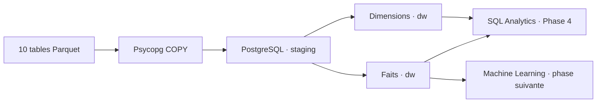
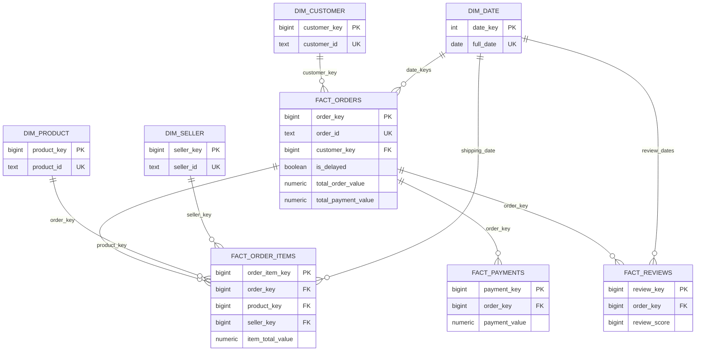

# Phase 3 — PostgreSQL Data Warehouse

> **Statut : Phase 3 terminée et validée.**
> Cette phase charge les tables Parquet de l'ETL dans PostgreSQL, matérialise une constellation de faits et vérifie les volumes, clés, relations et montants.

## Table des matières

1. [Présentation et objectifs](#section-1)
2. [Architecture et technologies](#section-2)
3. [Schéma staging](#section-3)
4. [Modèle dimensionnel](#section-4)
5. [Chargement du Data Warehouse](#section-5)
6. [Règles métier](#section-6)
7. [Tests et validations](#section-7)
8. [Résultats analytiques initiaux](#section-8)
9. [Reproductibilité](#section-9)
10. [Décisions techniques et limites](#section-10)
11. [Livrables](#section-11)
12. [Conclusion et transition](#section-12)

<a id="section-1"></a>

## 1. Présentation et objectifs

La Phase 3 transforme les dix tables Parquet produites en [Phase 2](PHASE_2_DATA_CLEANING_ETL.md) en un Data Warehouse PostgreSQL contraint et analysable. Elle sépare la zone de chargement des structures dimensionnelles afin de conserver un point de contrôle entre les données préparées et le modèle analytique.

Les objectifs sont :

- créer les schémas PostgreSQL `staging` et `dw` ;
- charger les Parquet en respectant les types et dépendances ;
- matérialiser les dimensions et tables de faits ;
- appliquer les clés primaires, étrangères, uniques et contraintes métier ;
- calculer les mesures de livraison au niveau commande ;
- réconcilier volumes et montants entre les couches ;
- fournir une base stable à la couche SQL Analytics et Power BI.

<a id="section-2"></a>

## 2. Architecture et technologies

### 2.1 Flux de données



| Composant | Rôle |
|---|---|
| PostgreSQL 18.1 | Stockage relationnel, contraintes et calculs SQL |
| Python 3.12, Pandas, PyArrow | Lecture des Parquet et préparation des valeurs |
| Psycopg 3 | Connexion et chargement `COPY` |
| `python-dotenv` | Lecture locale des paramètres de connexion |
| SQL | Création, chargement et validation du modèle |

La base documentée est `ecommerce_dw`. Le script [`01_create_schemas.sql`](../sql/01_create_schemas.sql) crée `staging` et `dw`. Le schéma `analytics` appartient à la Phase 4.

### 2.2 Pourquoi une constellation de faits ?

Le modèle possède plusieurs processus à des grains différents : commande, article, transaction de paiement et avis. Il ne s'agit donc pas d'une étoile unique stricte, mais d'une **constellation de faits** partageant des dimensions et une table de commandes centrale.

<a id="section-3"></a>

## 3. Schéma staging

### 3.1 Rôle

`staging` reçoit les données préparées sans les remodeler en dimensions et faits. Les tables SQL reproduisent les colonnes des Parquet et ajoutent les contraintes relationnelles absentes des fichiers.

| Table staging | Lignes | Clé |
|---|---:|---|
| `customers_clean` | 99 441 | `customer_id` |
| `sellers_clean` | 3 095 | `seller_id` |
| `products_clean` | 32 951 | `product_id` |
| `geolocation_zip` | 19 015 | `geolocation_zip_code_prefix` |
| `orders_clean` | 99 441 | `order_id` |
| `order_items_clean` | 112 650 | (`order_id`, `order_item_id`) |
| `order_payments_clean` | 103 886 | (`order_id`, `payment_sequential`) |
| `order_payments_aggregated` | 99 440 | `order_id` |
| `order_reviews_clean` | 99 224 | (`review_id`, `order_id`) |
| `order_reviews_aggregated` | 98 673 | `order_id` |
| **Total** | **767 816** |  |

Les définitions se trouvent dans [`01_create_staging_tables.sql`](../sql/staging/01_create_staging_tables.sql) et [`02_create_remaining_tables.sql`](../sql/staging/02_create_remaining_tables.sql).

### 3.2 Contraintes principales

- clés primaires simples ou composites sur les grains validés en ETL ;
- clés étrangères des commandes, articles, paiements et avis ;
- `price > 0`, `freight_value >= 0` et cohérence de `item_total_value` ;
- notes d'avis comprises entre 1 et 5 ;
- ratios GPS compris entre 0 et 1 ;
- cohérence entre observations GPS valides, invalides et totales.

### 3.3 Chargement Python

[`src/etl/load.py`](../src/etl/load.py) lit les dix Parquet dans l'ordre de leurs dépendances et utilise `COPY ... FROM STDIN` par lots de 5 000 lignes. Il :

- exige cinq variables de connexion dans un fichier `.env` local ;
- convertit les montants en `Decimal` pour respecter `NUMERIC(15,2)` ;
- recalcule `item_total_value` après conversion monétaire ;
- convertit certaines colonnes produit en entiers nullables ;
- remplace les valeurs manquantes Pandas par `None` ;
- compare le nombre de lignes chargé au nombre de lignes Parquet.

Le chargeur exige que les dix tables de staging soient **vides** avant le démarrage et exécute l'ensemble dans une transaction. Il prend donc en charge le chargement initial contrôlé, pas un chargement incrémental.

<a id="section-4"></a>

## 4. Modèle dimensionnel

### 4.1 Dimensions

| Dimension | Granularité | Lignes | Clé de substitution |
|---|---|---:|---|
| `dw.dim_customer` | Un `customer_id` | 99 441 | `customer_key` |
| `dw.dim_product` | Un `product_id` | 32 951 | `product_key` |
| `dw.dim_seller` | Un `seller_id` | 3 095 | `seller_key` |
| `dw.dim_date` | Un jour calendaire | 1 314 | `date_key` au format `YYYYMMDD` |

La dimension calendrier couvre la période du **4 septembre 2016 au 9 avril 2020**. Elle est construite avec `generate_series` entre les dates minimale et maximale de tous les événements utiles : commandes, expéditions, livraisons, articles et avis.

### 4.2 Tables de faits

| Fait | Granularité | Lignes | Clé métier unique |
|---|---|---:|---|
| `dw.fact_orders` | Une commande | 99 441 | `order_id` |
| `dw.fact_order_items` | Un article de commande | 112 650 | (`order_id`, `order_item_id`) |
| `dw.fact_payments` | Une transaction | 103 886 | (`order_id`, `payment_sequential`) |
| `dw.fact_reviews` | Un avis associé à une commande | 99 224 | (`review_id`, `order_id`) |

Le schéma `dw` contient **552 002 lignes** au total, dimensions et faits confondus.

### 4.3 Relations principales



Le diagramme regroupe visuellement les nombreuses références à `dim_date`. Les scripts SQL restent la source exhaustive des colonnes et contraintes.

<a id="section-5"></a>

## 5. Chargement du Data Warehouse

### 5.1 Ordre d'exécution

1. Créer `staging` et `dw` avec [`01_create_schemas.sql`](../sql/01_create_schemas.sql).
2. Créer les dix tables de staging.
3. Charger les Parquet avec [`load.py`](../src/etl/load.py).
4. Créer puis charger les dimensions métier.
5. Construire `dim_date` sur la plage de dates observée.
6. Créer les quatre tables de faits.
7. Charger `fact_orders`, puis articles, paiements et avis.
8. Exécuter les validations SQL.

### 5.2 Dimensions et faits

Les dimensions utilisent des clés de substitution `IDENTITY` et conservent une contrainte unique sur la clé métier. [`02_load_dimensions.sql`](../sql/warehouse/02_load_dimensions.sql) charge clients, produits et vendeurs.

[`05_load_fact_orders.sql`](../sql/warehouse/05_load_fact_orders.sql) agrège d'abord les articles par commande et joint séparément les paiements agrégés. Cette préparation évite de multiplier les montants lorsqu'une commande possède plusieurs articles ou paiements.

Les autres faits sont chargés par :

- [`07_load_fact_order_items.sql`](../sql/warehouse/07_load_fact_order_items.sql) ;
- [`08_load_fact_payments.sql`](../sql/warehouse/08_load_fact_payments.sql) ;
- [`09_load_fact_reviews.sql`](../sql/warehouse/09_load_fact_reviews.sql).

Les scripts dimensionnels et factuels utilisent `ON CONFLICT ... DO NOTHING` pour ne pas réinsérer une clé existante. Cette protection ne constitue toutefois pas une stratégie de mise à jour incrémentale : elle ne met pas à jour les lignes modifiées et le chargeur de staging exige des tables vides.

### 5.3 Correction de la règle de retard

La règle correcte compare les **dates calendaires**, pas les heures :

```sql
delivered_timestamp::date > estimated_delivery_timestamp::date
```

[`06_fix_delivery_delay.sql`](../sql/warehouse/06_fix_delivery_delay.sql) trace la correction appliquée aux données déjà chargées. Le script actuel de chargement de `fact_orders` intègre également cette règle, garantissant qu'une livraison effectuée le jour estimé n'est pas considérée en retard à cause de l'heure.

<a id="section-6"></a>

## 6. Règles métier

### 6.1 Commandes et montants

- Toutes les commandes sont conservées, y compris celles sans livraison réelle.
- Les articles sont agrégés par commande avant leur intégration dans `fact_orders`.
- Les paiements sont agrégés séparément.
- `total_order_value` représente prix des articles + frais de livraison.
- `total_payment_value` reste une mesure distincte et peut différer du total des articles.

### 6.2 Livraison

- `delivery_days` mesure la durée décimale entre achat et livraison pour les commandes livrées.
- `delivery_delay_days` mesure l'écart en jours calendaires entre livraison réelle et date estimée.
- `is_delayed = TRUE` uniquement lorsque la date réelle est strictement postérieure à la date estimée.
- Sans date réelle exploitable, les mesures et le statut de retard restent `NULL`.

### 6.3 Paiements et avis

- Une transaction est identifiée par (`order_id`, `payment_sequential`).
- Un avis est identifié par (`review_id`, `order_id`) ; `review_id` seul n'est pas unique.
- Les flags de qualité issus de l'ETL sont conservés dans les faits.

### 6.4 Précaution de jointure

Une commande peut posséder plusieurs articles, paiements et avis. Joindre directement les trois faits à `fact_orders` produit potentiellement un produit cartésien. Toute analyse au grain commande doit agréger chaque fait séparément avant de les combiner.

<a id="section-7"></a>

## 7. Tests et validations

### 7.1 Scripts

| Couche | Script | Contrôles principaux |
|---|---|---|
| Staging | [`01_validate_staging.sql`](../sql/validation/01_validate_staging.sql) | Volumes, articles orphelins, montants, dates de livraison, avis |
| Data Warehouse | [`02_validate_warehouse.sql`](../sql/validation/02_validate_warehouse.sql) | Volumes, clés métier, réconciliation financière, retards et clés étrangères |

### 7.2 Résultats documentés

| Contrôle | Résultat |
|---|---|
| Comparaison `staging` / `dw` | 7/7 tables contrôlées en `PASS` |
| Unicité des clés métier des quatre faits | Conforme |
| Total articles et livraison | 15 843 553,24 BRL dans les deux couches ; écart 0,00 |
| Total paiements | 16 008 872,12 BRL dans les deux couches ; écart 0,00 |
| Cohérence de `delivery_delay_days` et `is_delayed` | Conforme |
| Articles orphelins vers commandes | 0 |
| Paiements orphelins vers commandes | 0 |
| Avis orphelins vers commandes | 0 |

Ces résultats proviennent du chargement validé et documenté. Les requêtes versionnées permettent de les reproduire, mais ne constituent pas à elles seules un journal horodaté d'exécution.

<a id="section-8"></a>

## 8. Résultats analytiques initiaux

### 8.1 Livraison

| Indicateur | Résultat |
|---|---:|
| Commandes | 99 441 |
| Commandes `delivered` | 96 478 |
| Commandes en retard | 6 534 |
| Commandes à temps | 89 936 |
| Statut de retard inconnu | 2 971 |
| Taux de retard parmi les commandes évaluables | 6,77 % |
| Durée moyenne de livraison | 12,56 jours |
| Écart moyen à la date estimée | -11,88 jours |

Le taux de retard est `6 534 / (6 534 + 89 936)` : les statuts inconnus sont exclus du dénominateur.

### 8.2 Ventes et paiements

| Indicateur | Montant (BRL) |
|---|---:|
| Prix des articles | 13 591 643,70 |
| Frais de livraison | 2 251 909,54 |
| Total articles et livraison | 15 843 553,24 |
| Total des paiements | 16 008 872,12 |

Les deux totaux représentent des concepts différents. La validation garantit leur conservation entre couches, pas leur égalité.

### 8.3 Satisfaction client

| Indicateur | Résultat |
|---|---:|
| Avis | 99 224 |
| Note moyenne | 4,09 / 5 |
| Délai moyen de réponse | 3,15 jours |
| Avis avec message non vide | 40 950 |
| Temps de réponse négatifs | 0 |

| Note | Nombre d'avis |
|---:|---:|
| 1 | 11 424 |
| 2 | 3 151 |
| 3 | 8 179 |
| 4 | 19 142 |
| 5 | 57 328 |

<a id="section-9"></a>

## 9. Reproductibilité

### 9.1 Principaux fichiers

```text
src/etl/load.py
sql/01_create_schemas.sql
sql/staging/*.sql
sql/warehouse/*.sql
sql/validation/01_validate_staging.sql
sql/validation/02_validate_warehouse.sql
```

Les paramètres de connexion sont fournis localement dans `.env` et ne doivent pas être versionnés. Un exemple sans secret est disponible dans [`.env.example`](../.env.example).

Après configuration et chargement, la validation du Data Warehouse peut être lancée avec :

```powershell
psql -U ecommerce_user -h localhost -p 5432 -d ecommerce_dw -v ON_ERROR_STOP=1 -f "sql/validation/02_validate_warehouse.sql"
```

<a id="section-10"></a>

## 10. Décisions techniques et limites

### 10.1 Décisions

- Séparer le chargement brut contrôlé (`staging`) du modèle analytique (`dw`).
- Utiliser des clés de substitution dans les dimensions tout en conservant l'unicité métier.
- Modéliser plusieurs faits plutôt que forcer une étoile unique.
- Préagréger les faits multiples avant les calculs au niveau commande.
- Conserver les indicateurs de qualité de l'ETL.
- Calculer le retard en jours calendaires.
- Réconcilier séparément articles, transport et paiements.

### 10.2 Limites

- Le chargement Python de staging exige des tables vides.
- `ON CONFLICT DO NOTHING` protège des doublons, mais ne met pas à jour des données existantes.
- Il n'existe pas encore de stratégie complète de chargement incrémental ou de Slowly Changing Dimensions.
- Les scripts SQL doivent être exécutés dans l'ordre ; aucune orchestration de base n'est versionnée.
- Les validations sont des requêtes SQL reproductibles, mais aucun rapport d'exécution horodaté n'est conservé dans le repository.
- Le diagramme présente les relations principales et ne remplace pas le schéma physique complet.

<a id="section-11"></a>

## 11. Livrables

| Livrable | Emplacement |
|---|---|
| Chargeur PostgreSQL | [`src/etl/load.py`](../src/etl/load.py) |
| Création des schémas | [`sql/01_create_schemas.sql`](../sql/01_create_schemas.sql) |
| Tables staging | [`sql/staging/`](../sql/staging/) |
| Dimensions et faits | [`sql/warehouse/`](../sql/warehouse/) |
| Validations SQL | [`sql/validation/`](../sql/validation/) |
| Rapport de Phase 3 | [`docs/PHASE_3_DATA_WAREHOUSE.md`](PHASE_3_DATA_WAREHOUSE.md) |

<a id="section-12"></a>

## 12. Conclusion et transition

La Phase 3 fournit un Data Warehouse PostgreSQL de **552 002 lignes**, composé de quatre dimensions et quatre faits reliés par des clés contraintes. Les volumes, clés métier, références et montants ont été réconciliés entre staging et `dw`.

Ce socle alimente la **Phase 4 — SQL Analytics & Business Intelligence**, qui construit sept vues analytiques, un modèle sémantique Power BI, des mesures DAX et quatre dashboards documentés dans [`PHASE_4_SQL_ANALYTICS_BI.md`](PHASE_4_SQL_ANALYTICS_BI.md).

**Statut final : Phase 3 terminée et validée.**
