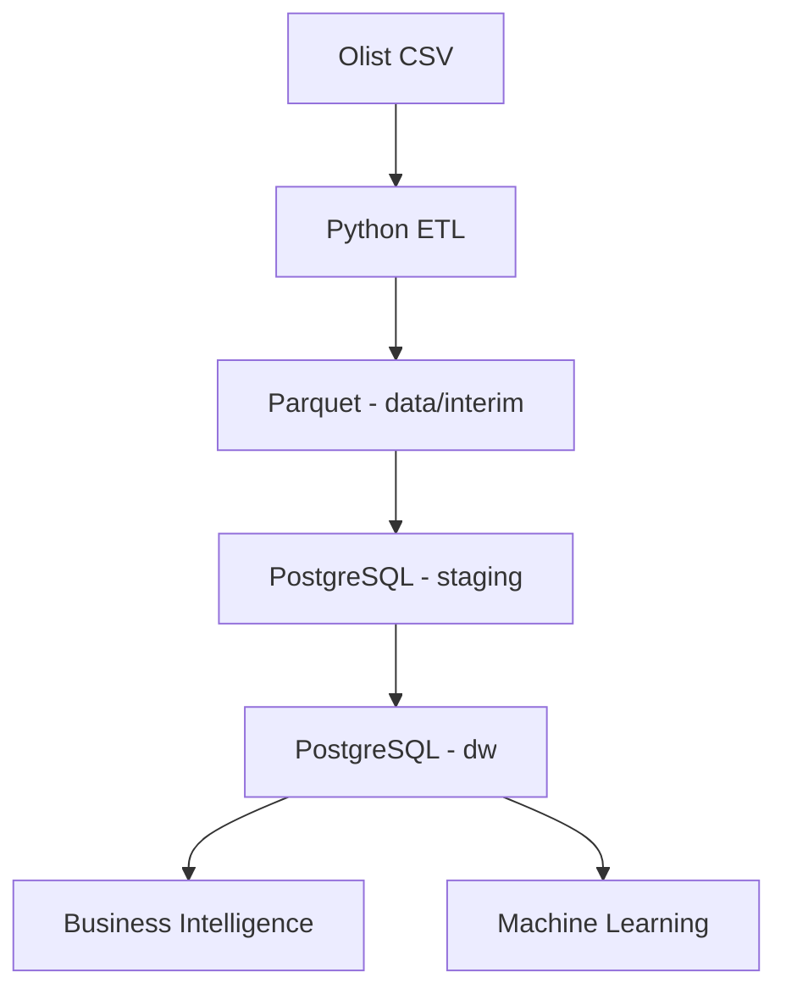
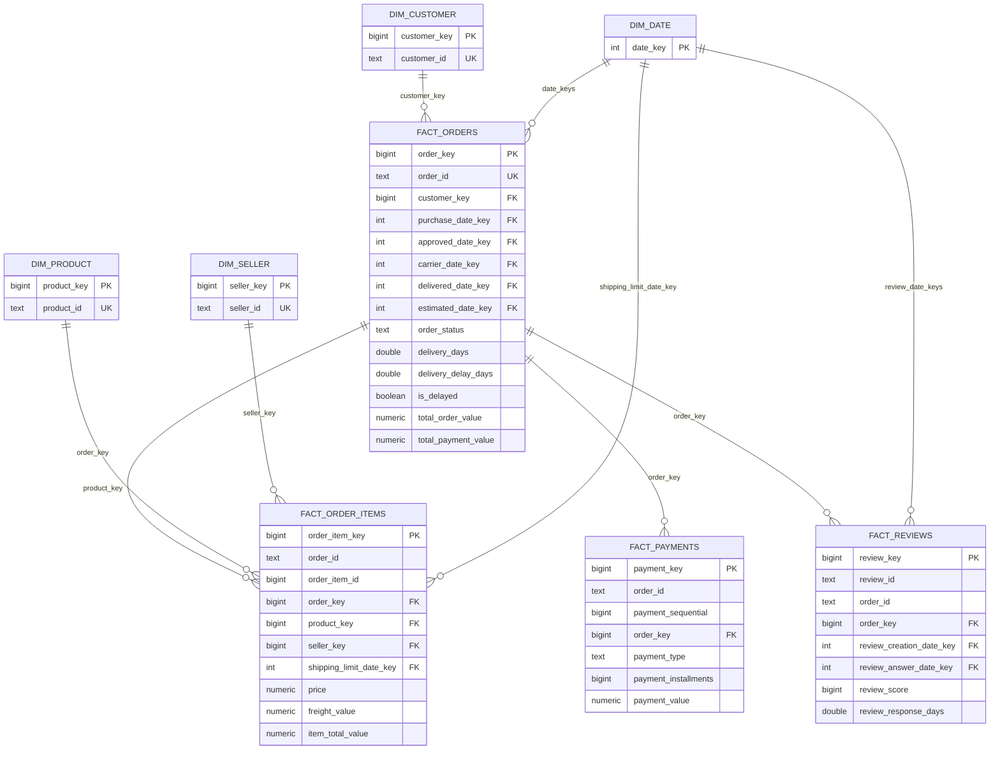

# Phase 3 — PostgreSQL Data Warehouse

## 1. Objectif

Concevoir et alimenter un Data Warehouse relationnel pour analyser les performances e-commerce à partir du **Brazilian E-Commerce Public Dataset by Olist**.

Cette phase couvre :

- La création de la base PostgreSQL et des schémas `staging` et `dw`.
- Le chargement des données nettoyées depuis les fichiers Parquet.
- La conception d'un modèle dimensionnel à dimensions partagées.
- Le chargement des dimensions et des tables de faits.
- La validation des volumes, des clés métier, des montants et de l'intégrité référentielle.

## 2. Technologies

- **PostgreSQL 18.1** : stockage, contraintes et requêtes analytiques.
- **Python 3.12**, **Pandas** et **PyArrow** : préparation et lecture des données Parquet.
- **Psycopg 3** : connexion à PostgreSQL et chargement via `COPY`.
- **SQL** : modélisation, chargements et contrôles.
- **python-dotenv** : configuration locale des connexions.

## 3. Architecture des données



- **Base de données** : `ecommerce_dw`.
- **Schéma `staging`** : données nettoyées et structurées issues du pipeline ETL.
- **Schéma `dw`** : dimensions et tables de faits destinées à l'analyse.

Les étapes BI et Machine Learning figurent comme **consommateurs prévus** du Data Warehouse ; elles ne font pas partie des livrables de cette phase.

## 4. Chargement du schéma staging

Le script `src/etl/load.py` utilise **Psycopg** et la commande PostgreSQL **`COPY`** pour transférer les données Parquet vers les tables `staging`.

Le chargement initial représente **10 tables et 767 816 lignes** :

| Table staging | Lignes |
|---|---:|
| `customers_clean` | 99 441 |
| `sellers_clean` | 3 095 |
| `products_clean` | 32 951 |
| `geolocation_zip` | 19 015 |
| `orders_clean` | 99 441 |
| `order_items_clean` | 112 650 |
| `order_payments_clean` | 103 886 |
| `order_payments_aggregated` | 99 440 |
| `order_reviews_clean` | 99 224 |
| `order_reviews_aggregated` | 98 673 |
| **Total** | **767 816** |

Les données nettoyées et leurs clés métier sont contrôlées avant l'alimentation du Data Warehouse.

## 5. Modèle dimensionnel

Le schéma `dw` repose sur une **constellation de faits** : quatre tables de faits partagent des dimensions métier et une dimension calendrier.

### 5.1. Dimensions

| Table | Granularité | Lignes |
|---|---|---:|
| `dw.dim_customer` | Un `customer_id` | 99 441 |
| `dw.dim_product` | Un `product_id` | 32 951 |
| `dw.dim_seller` | Un `seller_id` | 3 095 |
| `dw.dim_date` | Un jour calendaire | 1 314 |

La dimension calendrier couvre la période du **4 septembre 2016 au 9 avril 2020**. Les dimensions métier utilisent des **clés de substitution** générées par PostgreSQL.

### 5.2. Tables de faits

| Table | Granularité | Lignes |
|---|---|---:|
| `dw.fact_orders` | Une commande (`order_id`) | 99 441 |
| `dw.fact_order_items` | Un article de commande (`order_id`, `order_item_id`) | 112 650 |
| `dw.fact_payments` | Une transaction (`order_id`, `payment_sequential`) | 103 886 |
| `dw.fact_reviews` | Un avis associé à une commande (`review_id`, `order_id`) | 99 224 |

**Total du schéma `dw` : 552 002 lignes**, dimensions et faits confondus.

### 5.3. Diagramme ERD du Data Warehouse

Le diagramme ci-dessous présente les **principales clés et mesures**. Il s'agit d'une vue simplifiée du modèle physique : les attributs secondaires et certains indicateurs de qualité sont volontairement omis. Les relations de `dim_date` vers une même table sont regroupées visuellement ; elles correspondent à plusieurs clés étrangères distinctes.



**Note :** les couples (`order_id`, `order_item_id`), (`order_id`, `payment_sequential`) et (`review_id`, `order_id`) sont soumis à des contraintes d'unicité. Le diagramme n'exprime pas ces contraintes composites de façon exhaustive ; les scripts SQL constituent la référence du schéma physique.

### 5.4. Précautions pour les jointures analytiques

Les commandes peuvent posséder **plusieurs articles, plusieurs paiements et plusieurs avis**. Joindre directement ces trois tables de faits à `fact_orders` peut multiplier artificiellement les lignes et les montants. Pour produire des KPI au niveau commande, les faits doivent être **agrégés séparément par commande avant d'être joints**.

## 6. Règles métier

### 6.1. Commandes

- `fact_orders` conserve toutes les commandes, y compris celles sans date de livraison.
- Les valeurs des articles sont agrégées par commande avant leur intégration dans `fact_orders`.
- Les paiements sont agrégés séparément afin d'éviter la multiplication des montants.
- Les anomalies de livraison sont conservées dans des indicateurs de qualité dédiés.

### 6.2. Livraison

- **`delivery_days`** : durée réelle entre l'achat et la livraison, exprimée en jours décimaux.
- **`delivery_delay_days`** : différence en **jours calendaires** entre la date de livraison réelle et la date estimée ; une valeur positive indique un retard.
- **`is_delayed`** : `TRUE` si la date calendaire de livraison est strictement postérieure à la date estimée, `FALSE` sinon lorsque le calcul est possible.
- Lorsque la date de livraison réelle est absente, les indicateurs nécessitant cette date restent `NULL`.

### 6.3. Paiements

La clé métier d'une transaction est (`order_id`, `payment_sequential`). Les types de paiement, mensualités, montants et indicateurs de qualité sont conservés.

### 6.4. Avis clients

La clé métier d'un avis est (`review_id`, `order_id`) : `review_id` seul n'est **pas** unique dans les données sources. Cette granularité préserve toutes les associations avis-commandes.

## 7. Résultats analytiques initiaux

### 7.1. Livraison

| Indicateur | Résultat |
|---|---:|
| Commandes | 99 441 |
| Commandes avec statut `delivered` | 96 478 |
| Commandes en retard | 6 534 |
| Commandes à temps | 89 936 |
| Statut de retard inconnu | 2 971 |
| Taux de retard parmi les commandes évaluables | 6,77 % |
| Durée moyenne de livraison | 12,56 jours |
| Écart moyen à la date estimée | -11,88 jours |

Le taux de retard est calculé uniquement sur les commandes dont le statut de retard est connu : **6 534 / (6 534 + 89 936)**.

### 7.2. Ventes et paiements

| Indicateur | Montant (BRL) |
|---|---:|
| Prix des articles | 13 591 643,70 |
| Frais de livraison | 2 251 909,54 |
| **Total articles et livraison** | **15 843 553,24** |
| **Total des paiements** | **16 008 872,12** |

Ces deux derniers montants représentent des mesures distinctes et **ne sont pas supposés être égaux**. Les contrôles vérifient la conservation de chaque montant entre `staging` et `dw`, et non l'égalité des paiements avec les articles.

### 7.3. Satisfaction client

| Indicateur | Résultat |
|---|---:|
| Avis | 99 224 |
| Note moyenne | 4,09 / 5 |
| Délai moyen de réponse | 3,15 jours |
| Avis avec commentaire | 40 950 |
| Temps de réponse négatifs détectés | 0 |

Répartition des notes :

| Note | Nombre d'avis |
|---|---:|
| 1 | 11 424 |
| 2 | 3 151 |
| 3 | 8 179 |
| 4 | 19 142 |
| 5 | 57 328 |

## 8. Validation du Data Warehouse

Script de référence : `sql/validation/02_validate_warehouse.sql`.

### 8.1. Contrôles réalisés

| Contrôle | Résultat |
|---|---|
| Comparaison des volumes entre `staging` et `dw` | **7/7 PASS** |
| Unicité des clés métier des quatre tables de faits | **PASS** |
| Réconciliation du total des articles | **PASS** |
| Réconciliation du total des paiements | **PASS** |
| Cohérence des indicateurs de retard | **PASS** |
| Références orphelines des articles vers les commandes | **0** |
| Références orphelines des paiements vers les commandes | **0** |
| Références orphelines des avis vers les commandes | **0** |

### 8.2. Réconciliation financière

| Mesure | `staging` (BRL) | `dw` (BRL) | Écart (BRL) |
|---|---:|---:|---:|
| Articles et livraison | 15 843 553,24 | 15 843 553,24 | **0,00** |
| Paiements | 16 008 872,12 | 16 008 872,12 | **0,00** |

Ces résultats confirment les contrôles exécutés lors du chargement initial ; ils ne remplacent pas une suite exhaustive de tests automatisés.

## 9. Reproductibilité

### 9.1. Principaux fichiers

```text
src/
└── etl/
    └── load.py

sql/
├── 01_create_schemas.sql
├── staging/
│   ├── 01_create_staging_tables.sql
│   └── 02_create_remaining_tables.sql
├── warehouse/
│   ├── 01_create_dimensions.sql
│   ├── 02_load_dimensions.sql
│   ├── 03_load_dim_date.sql
│   ├── 04_create_facts.sql
│   ├── 05_load_fact_orders.sql
│   ├── 06_fix_delivery_delay.sql
│   ├── 07_load_fact_order_items.sql
│   ├── 08_load_fact_payments.sql
│   └── 09_load_fact_reviews.sql
└── validation/
    ├── 01_validate_staging.sql
    └── 02_validate_warehouse.sql
```

### 9.2. Vérification finale

Depuis la racine du projet, après avoir configuré localement PostgreSQL et chargé les données :

```powershell
psql -U ecommerce_user -h localhost -p 5432 -d ecommerce_dw -v ON_ERROR_STOP=1 -f "sql/validation/02_validate_warehouse.sql"
```

Le fichier `.env` contient des paramètres de connexion locaux et **ne doit pas être versionné**. Les identifiants et les données brutes doivent rester hors du dépôt public, selon les règles du projet.

Les scripts de chargement utilisent `ON CONFLICT DO NOTHING` pour éviter de réinsérer des clés métier déjà présentes. Ils prennent en charge le **chargement initial**, mais ne constituent pas encore une stratégie complète de mise à jour incrémentale des données existantes.

## 10. Limites et améliorations futures

- Automatiser l'orchestration et l'exécution ordonnée des scripts SQL.
- Ajouter des tests automatisés de reconstruction du Data Warehouse.
- Mettre en place des chargements incrémentaux et une gestion des mises à jour.
- Étendre les contrôles aux relations dimensionnelles et aux agrégations inter-tables.
- Enrichir le diagramme ERD avec l'ensemble des attributs et contraintes du modèle physique.
- Préparer des vues analytiques et des indicateurs pour Power BI.
- Construire un dataset de Machine Learning en évitant les **fuites de données temporelles**.

## 11. Conclusion

La phase 3 a permis de concevoir, charger et valider un **Data Warehouse PostgreSQL de 552 002 lignes**, composé de **quatre dimensions et quatre tables de faits**.

Les contrôles réalisés confirment la cohérence des volumes, l'unicité des clés métier, l'intégrité des relations vérifiées et la conservation des montants financiers transférés depuis `staging`.

Cette base constitue le socle des prochaines phases d'analyse décisionnelle et de prédiction des performances e-commerce.
