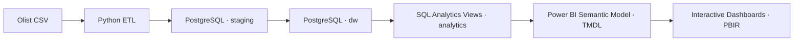

# Phase 4 — SQL Analytics & Business Intelligence

> **Statut final : Phase 4 terminée et validée.**
> Les sept vues analytiques, le modèle sémantique, les six mesures DAX et les quatre dashboards Power BI sont présents dans le repository. Les quatre dashboards ont été validés fonctionnellement par l'utilisateur dans Power BI Desktop.

## Table des matières

1. [Présentation et objectifs de la Phase 4](#section-1)
2. [Architecture analytique et BI](#section-2)
3. [Vues analytiques PostgreSQL](#section-3)
4. [Modèle sémantique Power BI et organisation PBIP](#section-4)
5. [Mesures DAX](#section-5)
6. [Dashboard 1 — Executive Overview](#section-6)
7. [Dashboard 2 — Sales & Product Analytics](#section-7)
8. [Dashboard 3 — Seller Performance](#section-8)
9. [Dashboard 4 — Delivery & Customer Experience](#section-9)
10. [Interactivité et gestion des filtres](#section-10)
11. [Formats numériques et présentation](#section-11)
12. [Tests et validations](#section-12)
13. [Résultats et indicateurs métiers](#section-13)
14. [Décisions techniques et limites](#section-14)
15. [Livrables de la Phase 4](#section-15)
16. [Conclusion et transition vers la Phase 5](#section-16)

<a id="section-1"></a>

## 1. Présentation et objectifs de la Phase 4

L'**E-Commerce Data Intelligence Platform** transforme le dataset public **Brazilian E-Commerce Public Dataset by Olist** en une chaîne analytique complète. Les phases précédentes ont exploré et nettoyé les données, puis construit un Data Warehouse PostgreSQL. La Phase 4 ajoute la couche qui rend ces données directement exploitables par les métiers : vues SQL contrôlées, modèle sémantique Power BI, mesures DAX et dashboards interactifs.

Le dataset Olist décrit notamment les commandes, articles, produits, vendeurs, paiements, livraisons et avis clients d'une marketplace brésilienne. Sa structure impose de distinguer plusieurs granularités : une commande peut contenir plusieurs articles, impliquer plusieurs vendeurs et recevoir plusieurs avis. Les rapports des [Phases 1](PHASE_1_DATA_EXPLORATION.md), [2](PHASE_2_DATA_CLEANING_ETL.md) et [3](PHASE_3_DATA_WAREHOUSE.md) documentent la préparation de ce socle.

La couche analytique répond à deux besoins complémentaires :

- **PostgreSQL** prépare des agrégats métiers reproductibles, proches des tables de faits et contrôlables par SQL.
- **Power BI** apporte les mesures réutilisables, les filtres contextuels, les comparaisons et la visualisation interactive.

Les dashboards répondent aux questions suivantes :

| Domaine | Questions métiers |
|---|---|
| Pilotage global | Quel est le volume de commandes, le montant des ventes, le panier moyen et le niveau de service ? |
| Ventes et produits | Comment les ventes évoluent-elles ? Quelles catégories contribuent le plus aux ventes et aux volumes d'articles ? |
| Vendeurs | Quels vendeurs et États génèrent le plus de ventes ? Quels vendeurs présentent les taux de retard les plus élevés ? |
| Livraison | Comment évoluent les livraisons à temps et en retard ? Quel volume a effectivement été livré ? |
| Expérience client | Quel est le niveau de satisfaction ? Comment varie-t-il dans le temps et selon le statut de livraison ? |

<a id="section-2"></a>

## 2. Architecture analytique et BI



### 2.1 Responsabilités des schémas PostgreSQL

| Schéma | Responsabilité |
|---|---|
| `staging` | Reçoit les tables nettoyées issues de l'ETL. Cette couche conserve une structure proche des données préparées et sert d'entrée contrôlée au chargement du Data Warehouse. |
| `dw` | Contient les dimensions et les faits à leurs granularités métier : commandes, articles, paiements et avis. Il centralise les clés, contraintes et mesures atomiques. |
| `analytics` | Expose sept vues prêtes à consommer, chacune construite pour un objectif métier et une granularité explicite. Cette couche limite la complexité du modèle BI et sécurise les agrégations récurrentes. |

Les vues SQL ne remplacent pas le Data Warehouse : elles constituent une **couche de préparation analytique**. Elles rapprochent les faits uniquement lorsque la granularité et la règle métier le permettent, calculent les indicateurs récurrents et fournissent des contrôles de réconciliation. Power BI importe ensuite ces vues sans recréer les jointures complexes entre tables de faits.

<a id="section-3"></a>

## 3. Vues analytiques PostgreSQL

### 3.1 Vue d'ensemble

| Vue | Granularité | Source principale | Usage Power BI |
|---|---|---|---|
| `analytics.vw_global_kpis` | Une ligne globale | Commandes, articles, paiements, avis | Référence SQL des KPI globaux ; table importée dans le modèle, sans référence directe dans les visuels actuels |
| `analytics.vw_monthly_sales` | Une ligne par mois d'achat | Commandes et articles | KPI de ventes, tendance mensuelle et commandes mensuelles |
| `analytics.vw_category_sales` | Une ligne par catégorie produit | Articles et produits | Top catégories par ventes, articles et part des ventes |
| `analytics.vw_seller_performance` | Une ligne par vendeur | Articles, vendeurs et commandes | KPI, classements, géographie, fiabilité et détail des vendeurs |
| `analytics.vw_delivery_performance` | Une ligne par mois d'achat | Commandes | KPI et tendances de livraison |
| `analytics.vw_customer_satisfaction` | Une ligne par mois de création d'avis | Avis et commandes | KPI, tendances et distribution des avis |
| `analytics.vw_delivery_satisfaction` | Une ligne par statut de livraison | Avis et commandes | Satisfaction globale par statut de livraison |

Les scripts de référence se trouvent dans [`sql/analytics/`](../sql/analytics/). Les colonnes décrites ci-dessous proviennent directement de ces scripts et des tables TMDL correspondantes.

### 3.2 `analytics.vw_global_kpis`

**Fichier :** [`01_create_global_kpis.sql`](../sql/analytics/01_create_global_kpis.sql)

- **Objectif :** consolider les principaux indicateurs globaux dans une seule ligne.
- **Granularité :** une ligne pour l'ensemble du périmètre.
- **Sources :** `dw.fact_orders`, `dw.fact_order_items`, `dw.fact_payments` et `dw.fact_reviews`.
- **Champs principaux :** `total_orders`, `delivered_orders`, `orders_with_items`, `total_sales`, `total_product_revenue`, `total_freight`, `avg_order_value`, `total_payments`, `delayed_orders`, `delay_rate`, `avg_delivery_days`, `total_reviews`, `avg_review_score` et `satisfaction_rate`.

La vue calcule séparément les commandes, les ventes, les paiements et les avis, puis combine quatre agrégats à une ligne par `CROSS JOIN`. Cette stratégie évite de joindre directement plusieurs tables de faits et donc de multiplier artificiellement les montants ou les comptes.

Les ventes correspondent à la somme de `item_total_value`, c'est-à-dire **prix de l'article + frais de livraison**. Le panier moyen divise ces ventes par le nombre de commandes contenant au moins un article. Le taux de retard utilise uniquement les commandes évaluables, tandis que la satisfaction correspond aux avis dont la note est supérieure ou égale à 4.

```sql
ROUND(
    100.0 * o.delayed_orders /
    NULLIF(o.evaluated_orders, 0),
    2
) AS delay_rate
```

La vue est importée dans le modèle sémantique comme référence analytique globale. Les visuels actuels utilisent toutefois les mesures DAX fondées sur les vues mensuelles afin de conserver un comportement correct sous filtre.

### 3.3 `analytics.vw_monthly_sales`

**Fichier :** [`02_create_monthly_sales.sql`](../sql/analytics/02_create_monthly_sales.sql)

- **Objectif :** suivre les commandes, les ventes et leur évolution dans le temps.
- **Granularité :** une ligne par `sales_month`, dérivé de la date d'achat.
- **Sources :** `dw.fact_orders` et `dw.fact_order_items`.
- **Champs principaux :** `sales_month`, `total_orders`, `delivered_orders`, `orders_with_items`, `product_revenue`, `freight_revenue`, `total_sales`, `avg_order_value` et `sales_growth_pct`.

La vue génère d'abord un calendrier mensuel continu avec `GENERATE_SERIES`. Les agrégats de commandes et d'articles sont calculés séparément, puis raccordés à ce calendrier. `COALESCE` remplace par zéro les volumes et montants des mois sans activité ; le taux de croissance reste `NULL` lorsque le mois précédent est absent ou nul.

`total_orders` compte les commandes au grain commande. `orders_with_items` compte les commandes distinctes présentes dans les lignes d'articles. Cette distinction explique pourquoi le panier moyen utilise `orders_with_items` plutôt que toutes les commandes.

Cette vue alimente les KPI de ventes, les slicers temporels, **Monthly Sales Trend** et **Monthly Orders**.

### 3.4 `analytics.vw_category_sales`

**Fichier :** [`03_create_category_sales.sql`](../sql/analytics/03_create_category_sales.sql)

- **Objectif :** analyser la contribution commerciale des catégories de produits.
- **Granularité :** une ligne par `category_name`.
- **Sources :** `dw.fact_order_items` et `dw.dim_product`.
- **Champs principaux :** `category_name`, `items_sold`, `total_orders`, `distinct_products`, `product_revenue`, `freight_revenue`, `total_sales`, `avg_item_price`, `sales_share_pct` et `sales_rank`.

Une ligne de commande représente un article vendu : `COUNT(*)` fournit donc `items_sold`. Les commandes sont comptées distinctement dans chaque catégorie. Les catégories sans traduction sont regroupées sous `unknown`. La part des ventes est calculée par rapport à la somme de toutes les catégories et le rang utilise `DENSE_RANK()` sur `total_sales` décroissant.

Cette vue alimente les Top 10 par ventes et articles, ainsi que le graphique **Sales Share (%) - Top 10 only (partial, not 100%)**. Ce dernier indique explicitement qu'un Top 10 est une vue partielle et ne doit pas être interprété comme 100 % des ventes.

### 3.5 `analytics.vw_seller_performance`

**Fichier :** [`04_create_seller_performance.sql`](../sql/analytics/04_create_seller_performance.sql)

- **Objectif :** comparer les vendeurs sur les ventes, les commandes, la géographie et la fiabilité des livraisons.
- **Granularité :** une ligne par vendeur.
- **Sources :** `dw.fact_order_items`, `dw.dim_seller` et `dw.fact_orders`.
- **Champs principaux :** `seller_id`, `seller_city`, `seller_state`, `total_orders`, `items_sold`, `product_revenue`, `freight_revenue`, `total_sales`, `avg_order_value`, `delivered_orders`, `evaluated_orders`, `delayed_orders`, `delay_rate`, `sales_share_pct` et `sales_rank`.

Le CTE `seller_order_metrics` agrège d'abord les articles par couple vendeur–commande. Cette étape empêche qu'une commande contenant plusieurs articles du même vendeur soit comptée plusieurs fois pour ce vendeur. La vue compte ensuite une occurrence par vendeur et par commande.

Une commande peut néanmoins contenir plusieurs vendeurs. Elle apparaît alors une fois chez chacun d'eux. Par conséquent, `SUM(total_orders)` sur l'ensemble des vendeurs peut dépasser le nombre global de commandes distinctes. Ce total est un volume **attribué aux vendeurs**, et non un total global de commandes uniques.

Le taux de retard SQL est calculé sur les commandes évaluées :

```sql
ROUND(
    100.0 * delayed_orders /
    NULLIF(evaluated_orders, 0),
    2
) AS delay_rate
```

Dans le tableau de fiabilité Power BI, le ratio est recalculé à partir des sommes de `delayed_orders` et `evaluated_orders`, ce qui préserve la pondération correcte sous filtre.

### 3.6 `analytics.vw_delivery_performance`

**Fichier :** [`05_create_delivery_performance.sql`](../sql/analytics/05_create_delivery_performance.sql)

- **Objectif :** suivre les volumes et la ponctualité des livraisons dans le temps.
- **Granularité :** une ligne par `purchase_month`.
- **Source :** `dw.fact_orders`.
- **Champs principaux :** `total_orders`, `delivered_orders`, `evaluated_orders`, `delayed_orders`, `on_time_orders`, `unknown_delivery_status`, `delay_rate`, `on_time_rate`, `avg_delivery_days` et `avg_delivery_delay_days`.

Les commandes sont réparties entre retard, livraison à temps et statut inconnu selon `is_delayed`. Les taux utilisent `evaluated_orders` comme dénominateur : les commandes dont le statut de retard est inconnu ne diminuent donc pas artificiellement les taux.

Les contrôles SQL vérifient notamment :

- `total_orders = evaluated_orders + unknown_delivery_status` ;
- `evaluated_orders = delayed_orders + on_time_orders`.

Cette vue alimente les mesures globales de livraison et les graphiques temporels du Dashboard 4.

### 3.7 `analytics.vw_customer_satisfaction`

**Fichier :** [`06_create_customer_satisfaction.sql`](../sql/analytics/06_create_customer_satisfaction.sql)

- **Objectif :** suivre la satisfaction et la distribution des avis dans le temps.
- **Granularité :** une ligne par `review_month`, construit à partir de la date de création de l'avis.
- **Sources :** `dw.fact_reviews` et `dw.fact_orders`.
- **Champs principaux :** `total_reviews`, `reviewed_orders`, `positive_reviews`, `negative_reviews`, `neutral_reviews`, `avg_review_score`, `avg_response_days`, `reviews_with_message`, `reviews_for_delayed_orders`, `reviews_for_on_time_orders`, `satisfaction_rate`, `dissatisfaction_rate` et `message_rate`.

Les avis positifs ont une note de 4 ou 5, les avis négatifs une note de 1 ou 2 et les avis neutres une note de 3. Le nombre d'avis et le nombre de commandes évaluées sont distincts, car une commande peut posséder plusieurs avis.

Le dénominateur des taux est `total_reviews`. Le script vérifie également que :

```text
total_reviews = positive_reviews + negative_reviews + neutral_reviews
```

`review_month` décrit le moment où l'avis est créé ; il ne doit pas être confondu avec `purchase_month`, qui décrit le moment de l'achat.

### 3.8 `analytics.vw_delivery_satisfaction`

**Fichier :** [`07_create_delivery_satisfaction.sql`](../sql/analytics/07_create_delivery_satisfaction.sql)

- **Objectif :** comparer la satisfaction client selon la ponctualité de livraison.
- **Granularité :** une ligne par `delivery_status`.
- **Sources :** `dw.fact_reviews` et `dw.fact_orders`.
- **Champs principaux :** `delivery_status`, `total_reviews`, `reviewed_orders`, `avg_review_score`, `positive_reviews`, `negative_reviews`, `satisfaction_rate` et `dissatisfaction_rate`.

Les statuts sont construits directement à partir de `is_delayed` : `delayed`, `on_time` ou `unknown`. La vue conserve une granularité globale par statut et ne contient aucune dimension mensuelle. Son graphique Power BI reste donc global lorsque les slicers mensuels du Dashboard 4 sont utilisés.

### 3.9 Précautions communes de granularité

- Une **commande**, une **ligne de commande** et un **avis** ne représentent pas la même unité d'analyse.
- Les faits articles, paiements et avis ne doivent pas être joints naïvement au niveau commande, sous peine de créer un produit cartésien et de doubler les montants.
- Les vues agrègent les faits séparément ou à un grain intermédiaire contrôlé avant toute combinaison.
- Les taux globaux sont calculés à partir des numérateurs et dénominateurs cumulés ; une moyenne simple de taux mensuels ou vendeurs donnerait un résultat non pondéré.
- Les valeurs inconnues sont conservées lorsqu'elles ont un sens métier, notamment pour le statut de livraison.

<a id="section-4"></a>

## 4. Modèle sémantique Power BI et organisation PBIP

### 4.1 Organisation des fichiers

```text
powerbi/
├── ecommerce_data_intelligence.pbip
├── ecommerce_data_intelligence.Report/
│   ├── definition.pbir
│   └── definition/
│       ├── report.json
│       └── pages/
│           ├── pages.json
│           └── <page-id>/
│               ├── page.json
│               └── visuals/<visual-id>/visual.json
└── ecommerce_data_intelligence.SemanticModel/
    ├── definition.pbism
    └── definition/
        ├── model.tmdl
        ├── relationships.tmdl
        └── tables/*.tmdl
```

Le point d'entrée est [`ecommerce_data_intelligence.pbip`](../powerbi/ecommerce_data_intelligence.pbip). Le fichier [`definition.pbir`](../powerbi/ecommerce_data_intelligence.Report/definition.pbir) relie le rapport à son modèle sémantique par un chemin relatif.

| Élément | Rôle |
|---|---|
| PBIP | Décrit le projet Power BI et référence l'artefact de rapport. |
| PBIR | Stocke la définition textuelle et versionnable du rapport. |
| TMDL | Décrit le modèle sémantique, ses tables, colonnes, partitions, relations et mesures. |
| [`pages.json`](../powerbi/ecommerce_data_intelligence.Report/definition/pages/pages.json) | Définit l'ordre des quatre pages et la page active. |
| `page.json` | Définit le nom, le canvas et, le cas échéant, les interactions explicites d'une page. |
| `visual.json` | Décrit un visuel : type, position, champs, agrégations, filtres et format. |

Les quatre pages ont un canvas de **1920 × 1080** et apparaissent dans l'ordre suivant : Executive Overview, Sales & Product Analytics, Seller Performance, puis Delivery & Customer Experience.

### 4.2 Connexion et modèle

Les partitions TMDL des sept tables analytiques utilisent une connexion d'import PostgreSQL vérifiable dans les fichiers du modèle :

```powerquery
Source = PostgreSQL.Database("localhost:5432", "ecommerce_dw")
```

Chaque partition sélectionne une vue du schéma `analytics`. Aucun identifiant ni mot de passe n'est stocké dans ces définitions.

Le fichier [`model.tmdl`](../powerbi/ecommerce_data_intelligence.SemanticModel/definition/model.tmdl) référence les sept vues et la table `_Measures`. Les seules relations consignées dans [`relationships.tmdl`](../powerbi/ecommerce_data_intelligence.SemanticModel/definition/relationships.tmdl) relient trois dates à leurs tables de calendrier locales automatiques :

- `sales_month` ;
- `purchase_month` ;
- `review_month`.

Il n'existe pas de relation artificielle entre les vues analytiques agrégées. Cette isolation évite de propager des filtres entre des tables dont les granularités sont incompatibles.

### 4.3 Intérêt du format projet

PBIP, PBIR et TMDL permettent de versionner des définitions textuelles plutôt qu'un unique fichier PBIX binaire. Les bénéfices sont la revue de code, la traçabilité des changements, la maintenance ciblée, la reproductibilité et l'intégration dans un workflow Git.

Cette approche impose néanmoins une discipline : Power BI Desktop peut normaliser ou réécrire certains fichiers PBIR lors d'une sauvegarde. Les modifications externes doivent être effectuées avec Power BI Desktop fermé, puis validées après réouverture et sauvegarde.

<a id="section-5"></a>

## 5. Mesures DAX

Les six mesures sont définies dans [`_Measures.tmdl`](../powerbi/ecommerce_data_intelligence.SemanticModel/definition/tables/_Measures.tmdl). Les formules ci-dessous reprennent exactement les expressions du modèle.

```DAX
Total Sales =
    SUM('analytics vw_monthly_sales'[total_sales])

Total Orders =
    SUM('analytics vw_monthly_sales'[total_orders])

Average Order Value =
    DIVIDE(
        [Total Sales],
        SUM('analytics vw_monthly_sales'[orders_with_items])
    )

Delay Rate =
    DIVIDE(
        SUM('analytics vw_delivery_performance'[delayed_orders]),
        SUM('analytics vw_delivery_performance'[evaluated_orders])
    )

On-Time Delivery Rate =
    DIVIDE(
        SUM('analytics vw_delivery_performance'[on_time_orders]),
        SUM('analytics vw_delivery_performance'[evaluated_orders])
    )

Customer Satisfaction Rate =
    DIVIDE(
        SUM('analytics vw_customer_satisfaction'[positive_reviews]),
        SUM('analytics vw_customer_satisfaction'[total_reviews])
    )
```

| Mesure | Objectif et calcul | Format | Dashboards |
|---|---|---|---|
| `Total Sales` | Somme des prix d'articles et frais de livraison agrégés par mois | `R$ #,##0.00` | Executive Overview ; Sales & Product Analytics |
| `Total Orders` | Somme des commandes mensuelles | `#,##0` | Executive Overview ; Sales & Product Analytics |
| `Average Order Value` | Ventes divisées par les commandes contenant des articles | `R$ #,##0.00` | Executive Overview ; Sales & Product Analytics |
| `Delay Rate` | Commandes en retard divisées par les commandes évaluées | `0.00%` | Executive Overview ; Delivery & Customer Experience |
| `On-Time Delivery Rate` | Commandes à temps divisées par les commandes évaluées | `0.00%` | Executive Overview ; Delivery & Customer Experience |
| `Customer Satisfaction Rate` | Avis positifs divisés par l'ensemble des avis | `0.00%` | Executive Overview ; Delivery & Customer Experience |

`DIVIDE()` protège les ratios contre un dénominateur nul. Les trois mesures de taux renvoient une fraction comprise entre 0 et 1, puis le format Power BI l'affiche en pourcentage.

Le calcul à partir des sommes garantit une **moyenne pondérée implicite**. Par exemple, le taux de retard global est `SUM(delayed_orders) / SUM(evaluated_orders)` et non `AVERAGE(delay_rate)`. Un petit mois ou un petit vendeur ne reçoit ainsi pas le même poids qu'un groupe beaucoup plus volumineux.

<a id="section-6"></a>

## 6. Dashboard 1 — Executive Overview

**Définition :** [`page.json`](../powerbi/ecommerce_data_intelligence.Report/definition/pages/afccc91401495a570048/page.json)

Cette page synthétise la performance commerciale, la livraison et la satisfaction dans une vue de direction.

### 6.1 Contenu

- KPI : **Total Sales**, **Total Orders**, **Average Order Value**, **Delay Rate**, **On-Time Delivery Rate** et **Customer Satisfaction Rate**.
- Carte de synthèse **Delivery Performance · evaluated orders**.
- Carte de synthèse **Customer Satisfaction · positive reviews (scores 4–5)**.
- Courbe **Monthly Sales Trend** sur `sales_month`.
- Barres **Top 10 Product Categories** par `total_sales`.
- Slicer mensuel fondé sur `analytics vw_monthly_sales[sales_month]`.
- Note : **Filter applies to sales KPIs and monthly trend only**.

### 6.2 Sources et filtres

Les KPI commerciaux et la courbe utilisent `analytics vw_monthly_sales`. Les KPI de livraison utilisent `analytics vw_delivery_performance`, la satisfaction utilise `analytics vw_customer_satisfaction` et les catégories utilisent `analytics vw_category_sales`.

Des interactions `NoFilter` explicites empêchent le slicer de ventes d'affecter les visuels provenant de vues déconnectées. Le filtre s'applique aux KPI commerciaux et à la tendance mensuelle, mais pas aux KPI de livraison, à la satisfaction ni au Top 10 des catégories.

Cette page permet donc de lire ensemble les valeurs globales de référence sans suggérer qu'un mois d'achat filtre des avis ou des catégories sans dimension temporelle compatible.

<a id="section-7"></a>

## 7. Dashboard 2 — Sales & Product Analytics

**Définition :** [`page.json`](../powerbi/ecommerce_data_intelligence.Report/definition/pages/5e8b1c4f7a0d9362b5e4/page.json)

Cette page approfondit la dynamique des ventes, la demande mensuelle et la contribution des catégories.

### 7.1 Contenu

- Cartes **Total Sales**, **Total Orders** et **Average Order Value**.
- Courbe **Monthly Sales Trend**.
- Colonnes **Monthly Orders**.
- Barres **Top 10 Product Categories by Sales**.
- Barres **Top 10 Categories by Items Sold**.
- Barres **Sales Share (%) - Top 10 only (partial, not 100%)**.
- Slicer `sales_month` et note de portée du filtre.

Les classements Top 10 sont triés de façon décroissante et utilisent `analytics vw_category_sales`. Le graphique de part des ventes annonce explicitement sa couverture partielle : il ne présente pas le Top 10 comme l'intégralité du marché.

### 7.2 Définitions commerciales

| Indicateur | Définition |
|---|---|
| Product Revenue | Somme de `price`, hors frais de livraison |
| Freight Revenue | Somme de `freight_value` |
| Total Sales | `product_revenue + freight_revenue`, via `item_total_value` |
| Average Order Value | `Total Sales / orders_with_items` |

Le slicer mensuel filtre les trois KPI et les deux graphiques temporels. Trois interactions `NoFilter` protègent les graphiques de catégories, car `analytics.vw_category_sales` ne possède pas de mois et reste déconnectée de la vue mensuelle.

La principale limite est inhérente aux vues préagrégées : la page compare correctement les axes disponibles, mais elle ne peut pas décomposer une catégorie par mois sans une vue ou un modèle à une granularité catégorie–mois.

<a id="section-8"></a>

## 8. Dashboard 3 — Seller Performance

**Définition :** [`page.json`](../powerbi/ecommerce_data_intelligence.Report/definition/pages/7c9d2e5f8a1b3647c0d3/page.json)

Cette page analyse les performances commerciales et opérationnelles des vendeurs.

### 8.1 Contenu

- **Active Sellers** : nombre distinct de `seller_id` présents dans la vue.
- **Seller Sales** : somme des ventes attribuées aux vendeurs.
- **Seller Orders (sum)** : somme des commandes par vendeur.
- **Top 10 Sellers by Sales**.
- **Top 10 Sellers by Orders**.
- **Sales by Seller State**.
- **Highest Delay Rates | Top 10, minimum 20 evaluated orders**.
- **Seller Details | Sorted by Total Sales**.
- Slicer géographique **Seller State (Brazil)**.
- Note sur les commandes multivendeurs.

Tous ces visuels utilisent `analytics.vw_seller_performance`. Le slicer d'État filtre donc les KPI, classements et tables dans un même contexte de vue.

### 8.2 Commandes multivendeurs

La vue possède une ligne par vendeur, mais une commande impliquant plusieurs vendeurs est attribuée à chacun d'eux. `Seller Orders (sum)` mesure l'activité cumulée par vendeur ; il ne représente pas un nombre global de commandes uniques et peut dépasser `Total Orders`.

### 8.3 Fiabilité des livraisons

Le tableau de fiabilité affiche le vendeur, les commandes retardées, les commandes évaluées et un calcul visuel DAX :

```DAX
DIVIDE([Delayed Orders], [Evaluated Orders])
```

Le filtre PBIR retient les vendeurs ayant au moins **20 commandes évaluées**, puis sélectionne les dix taux de retard les plus élevés. Le seuil évite de placer en tête du classement un vendeur ayant un taux extrême calculé sur un échantillon trop faible.

Le ratio est construit avec `SUM(delayed_orders) / SUM(evaluated_orders)`. Cette approche conserve les numérateurs et dénominateurs visibles et s'adapte au slicer d'État. Additionner les taux SQL préagrégés serait incorrect ; en faire une moyenne simple donnerait le même poids à des vendeurs de tailles différentes.

Le choix d'une table analytique rend le classement explicable : l'utilisateur voit le taux, mais aussi le nombre de retards et la population évaluée qui le produisent.

<a id="section-9"></a>

## 9. Dashboard 4 — Delivery & Customer Experience

**Définition :** [`page.json`](../powerbi/ecommerce_data_intelligence.Report/definition/pages/4d8e1f6a9b2c7350e4d7/page.json)

Ce dashboard comporte **13 visuels** et a été validé par l'utilisateur dans Power BI Desktop.

### 9.1 Contenu et calculs

| Visuel | Source et calcul |
|---|---|
| Delay Rate | Mesure `_Measures[Delay Rate]` |
| On-Time Delivery Rate | Mesure `_Measures[On-Time Delivery Rate]` |
| Customer Satisfaction Rate | Mesure `_Measures[Customer Satisfaction Rate]` |
| Delivery Performance Over Time | `MAX(on_time_rate)` et `MAX(delay_rate)` par `purchase_month` |
| Delivery Volume Over Time | `SUM(delivered_orders)` par `purchase_month` |
| Customer Satisfaction Trend | `MAX(satisfaction_rate)` par `review_month` |
| Average Review Score Trend | `MAX(avg_review_score)` par `review_month` |
| Delivery Status vs Customer Satisfaction | `MAX(satisfaction_rate)` par `delivery_status` |
| Review Distribution | `SUM(positive_reviews)`, `SUM(negative_reviews)` et `SUM(neutral_reviews)` |
| Purchase Month | Slicer sur `analytics vw_delivery_performance[purchase_month]` |
| Review Month | Slicer sur `analytics vw_customer_satisfaction[review_month]` |
| Titre et sous-titre | Contexte du dashboard |
| Note explicative | Indépendance des périodes et caractère global du graphique par statut |

`MAX` ne sert pas ici à reconstruire un taux. Il sélectionne une valeur déjà préagrégée à une granularité où le SQL garantit une seule ligne par mois ou par statut. Les sommes sont réservées aux volumes additifs.

### 9.2 Périodes et slicers

`purchase_month` correspond au mois d'achat de la commande. `review_month` correspond au mois de création de l'avis. Un achat et son avis peuvent appartenir à des mois différents ; les deux axes ne sont donc pas interchangeables.

- Le slicer `purchase_month` filtre les deux KPI de livraison et les graphiques issus de `analytics.vw_delivery_performance`.
- Le slicer `review_month` filtre le KPI de satisfaction et les graphiques issus de `analytics.vw_customer_satisfaction`.
- **Delivery Status vs Customer Satisfaction** reste global, car `analytics.vw_delivery_satisfaction` ne comporte aucune dimension mensuelle et n'est reliée à aucune des deux vues.

Aucune relation artificielle n'a été créée pour simuler une propagation de filtres entre ces agrégats.

<a id="section-10"></a>

## 10. Interactivité et gestion des filtres

| Dashboard | Slicer | Visuels filtrés | Visuels volontairement non filtrés |
|---|---|---|---|
| Executive Overview | `sales_month` | KPI de ventes et tendance mensuelle | KPI de livraison, satisfaction et Top 10 catégories, protégés par `NoFilter` |
| Sales & Product Analytics | `sales_month` | Trois KPI de ventes, Monthly Sales Trend, Monthly Orders | Trois graphiques de catégories, protégés par `NoFilter` |
| Seller Performance | `seller_state` | KPI, classements, fiabilité et détails des vendeurs | Aucun visuel analytique d'une autre vue sur cette page |
| Delivery & Customer Experience | `purchase_month` | KPI de retard et livraison à temps, performance et volume de livraison | Visuels d'avis et satisfaction par statut |
| Delivery & Customer Experience | `review_month` | KPI de satisfaction, tendances d'avis et distribution des avis | Visuels de livraison et satisfaction par statut |

La cohérence provient autant de la configuration PBIR que du modèle : les vues sont déconnectées, donc un filtre ne traverse pas automatiquement une table incompatible. Les interactions explicites `NoFilter` des Dashboards 1 et 2 rendent en plus cette intention visible dans `page.json`.

Cette conception privilégie la justesse : un slicer n'est proposé que lorsqu'il existe une dimension compatible dans la source du visuel. Elle évite de donner l'illusion d'un filtre transversal qui n'aurait pas de base sémantique.

<a id="section-11"></a>

## 11. Formats numériques et présentation

Les quatre dashboards appliquent une règle commune : **afficher les valeurs complètes, sans abréviation K, M ou B**.

- `labelDisplayUnits = 1D` désactive les unités automatiques sur les cartes, axes ou étiquettes qui prennent cette propriété en charge.
- Les comptages utilisent `#,##0`.
- Les montants utilisent `R$ #,##0.00`.
- Les pourcentages utilisent `0.00%`.
- Les notes moyennes utilisent `0.00`.
- La culture du modèle est `fr-FR` ; le rendu final des séparateurs dépend également des paramètres régionaux Power BI.

Exemples de présentation attendue :

| Type | Valeur complète |
|---|---:|
| Vendeurs | 3 095 |
| Commandes | 99 441 |
| Ventes | R$ 15 843 553,24 |
| Taux de retard | 6,77 % |

L'inspection statique actuelle trouve **47 propriétés `labelDisplayUnits`**, toutes configurées à `1D`. Ce choix améliore la précision de lecture, mais exige des cartes suffisamment larges et des axes lisibles, ce qui a été pris en compte dans les canvas 1920 × 1080.

<a id="section-12"></a>

## 12. Tests et validations

### 12.1 Validations SQL

Le script [`03_validate_analytics.sql`](../sql/validation/03_validate_analytics.sql) définit 12 réconciliations entre les vues `analytics` et les faits du Data Warehouse :

| # | Contrôle |
|---:|---|
| 1 | Commandes globales |
| 2 | Somme des commandes mensuelles |
| 3 | Somme des ventes mensuelles |
| 4 | Somme des ventes par catégorie |
| 5 | Somme des ventes par vendeur |
| 6 | Somme des articles par vendeur |
| 7 | Commandes en retard |
| 8 | Somme des avis mensuels |
| 9 | Somme des avis par statut de livraison |
| 10 | Continuité du calendrier mensuel |
| 11 | Somme des articles par catégorie |
| 12 | Réconciliation de la distribution des avis |

Les instructions du projet consignent **12 contrôles passants**. Le repository versionne le script de validation, mais pas un export horodaté de sa sortie ; cette documentation ne prétend donc pas avoir réexécuté PostgreSQL lors de sa rédaction.

Les scripts de création des vues contiennent en complément des requêtes de contrôle ciblées : réconciliation des montants, cohérence des taux et partitions de volumes.

### 12.2 Validations techniques et statiques PBIR

L'inspection du projet a permis de vérifier :

- 55 fichiers JSON de définition syntaxiquement lisibles ;
- 4 pages dans l'ordre attendu ;
- 48 identifiants de visuels uniques ;
- 13 visuels sur Executive Overview, 11 sur Sales & Product Analytics, 11 sur Seller Performance et 13 sur Delivery & Customer Experience ;
- un canvas de 1920 × 1080 sur les quatre pages ;
- aucune collision d'identifiants ;
- aucun chevauchement ni dépassement du canvas ;
- les références aux tables, colonnes et mesures TMDL ;
- les agrégations non additives pour les taux et moyennes ;
- les formats numériques complets ;
- l'absence de relations artificielles entre vues analytiques.

Ces contrôles statiques valident la structure des fichiers, pas leur rendu par le moteur Power BI.

### 12.3 Validation fonctionnelle Power BI Desktop

**Statut : VALIDÉ PAR L'UTILISATEUR.**

Les tests fonctionnels ont été effectués par l'utilisateur dans Power BI Desktop, et non automatisés par Codex. Ils ont confirmé :

- l'affichage des quatre pages ;
- le chargement des visuels ;
- les valeurs des KPI ;
- le fonctionnement des slicers et interactions ;
- l'affichage des valeurs complètes ;
- la lisibilité des graphiques ;
- la sauvegarde et la réouverture du projet PBIP ;
- la persistance des dashboards.

<a id="section-13"></a>

## 13. Résultats et indicateurs métiers

| Indicateur | Valeur de référence | Définition et justification |
|---|---:|---|
| Total Orders | 99 441 | Nombre de lignes de `dw.fact_orders`, réconcilié par les vues globale et mensuelle |
| Total Sales | R$ 15 843 553,24 | Somme de `item_total_value`, soit prix des articles + frais de livraison |
| Average Order Value | ≈ R$ 160,58 | `Total Sales / orders_with_items` |
| Active Sellers | 3 095 | Nombre de vendeurs documenté dans les phases précédentes ; la carte compte les `seller_id` distincts présents dans la vue vendeur |
| Delay Rate | ≈ 6,77 % | Commandes en retard / commandes évaluées |
| On-Time Delivery Rate | ≈ 93,23 % | Commandes à temps / commandes évaluées |
| Customer Satisfaction Rate | ≈ 77,07 % | Avis de note 4 ou 5 / ensemble des avis |

Les valeurs `Total Orders`, `Total Sales`, `Active Sellers` et `Delay Rate` sont également documentées dans les rapports des phases précédentes ou les instructions du projet. Les valeurs du panier moyen, du taux à temps et de la satisfaction sont les points de contrôle validés dans Power BI et consignés dans le projet.

`Total Sales` mesure la valeur des articles et du transport dans les lignes de commande. Il ne doit pas être assimilé sans nuance à un chiffre d'affaires comptable reconnu. Le total des paiements constitue une mesure distincte.

La satisfaction de 77,07 % est cohérente avec la distribution documentée des avis : 19 142 notes de 4 et 57 328 notes de 5, sur 99 224 avis.

<a id="section-14"></a>

## 14. Décisions techniques et limites

### 14.1 Décisions structurantes

- **Vues PostgreSQL dédiées :** les calculs complexes et réconciliables restent proches des faits.
- **Séparation `dw` / `analytics` :** le modèle dimensionnel conserve les données atomiques, tandis que les vues servent les usages BI.
- **PBIP/PBIR/TMDL :** les définitions textuelles sont versionnables, relisibles et maintenables.
- **Mesures DAX centralisées :** les KPI sont réutilisés entre pages et restent cohérents sous filtre.
- **Agrégations adaptées au grain :** sommes pour les volumes, rapports de sommes pour les taux, `MAX` uniquement pour lire une valeur préagrégée unique par groupe.
- **Prévention du double comptage :** agrégation par commande ou vendeur–commande avant combinaison des faits.
- **Portée contrôlée des slicers :** aucune propagation simulée entre vues incompatibles.
- **Valeurs complètes :** les KPI et axes ne masquent pas la précision derrière des unités K/M/B.
- **Édition PBIR contrôlée :** Power BI Desktop est fermé lors des modifications externes, puis utilisé pour la validation fonctionnelle.

### 14.2 Limites connues

- Les sept vues ont des granularités différentes et ne peuvent pas être reliées arbitrairement.
- Les vues préagrégées limitent les croisements non prévus, par exemple catégorie par mois.
- Les commandes multivendeurs rendent la somme des commandes vendeur non comparable au total distinct global.
- Les mois d'achat et d'avis décrivent deux événements différents.
- Les taux préagrégés ne sont ni additifs ni directement moyennables.
- Les vues déconnectées ne se filtrent pas transversalement sans dimension commune démontrée.
- Les modifications manuelles de PBIR restent sensibles aux normalisations effectuées par Power BI Desktop.

<a id="section-15"></a>

## 15. Livrables de la Phase 4

| Livrable | Emplacement |
|---|---|
| Sept scripts de création des vues analytiques | [`sql/analytics/`](../sql/analytics/) |
| Suite de 12 contrôles analytiques | [`sql/validation/03_validate_analytics.sql`](../sql/validation/03_validate_analytics.sql) |
| Projet Power BI | [`powerbi/ecommerce_data_intelligence.pbip`](../powerbi/ecommerce_data_intelligence.pbip) |
| Définition PBIR du rapport | [`powerbi/ecommerce_data_intelligence.Report/`](../powerbi/ecommerce_data_intelligence.Report/) |
| Modèle sémantique TMDL | [`powerbi/ecommerce_data_intelligence.SemanticModel/`](../powerbi/ecommerce_data_intelligence.SemanticModel/) |
| Six mesures DAX | [`_Measures.tmdl`](../powerbi/ecommerce_data_intelligence.SemanticModel/definition/tables/_Measures.tmdl) |
| Quatre dashboards | [`pages/`](../powerbi/ecommerce_data_intelligence.Report/definition/pages/) |
| Rapport technique de la Phase 4 | [`PHASE_4_SQL_ANALYTICS_BI.md`](PHASE_4_SQL_ANALYTICS_BI.md) |

<a id="section-16"></a>

## 16. Conclusion et transition vers la Phase 5

La Phase 4 transforme le Data Warehouse PostgreSQL en un système décisionnel exploitable. Les sept vues analytiques rendent les règles métier explicites et testables ; le modèle TMDL centralise les tables et mesures ; les quatre dashboards PBIR couvrent la performance globale, les ventes, les vendeurs, la livraison et l'expérience client.

Les choix de granularité, de pondération des taux, de contrôle des filtres et de présentation numérique visent à préserver la justesse des résultats autant que leur lisibilité.

**Statut final : Phase 4 terminée et validée.**

La prochaine étape est la **Phase 5 — Machine Learning : prédiction des retards de livraison**. Elle exploitera les données historiques pour entraîner et évaluer des modèles prédictifs, en veillant à n'utiliser que les informations disponibles au moment de la prédiction et à éviter toute fuite de données temporelle. Aucun modèle de cette phase n'est présenté ici comme déjà construit.
