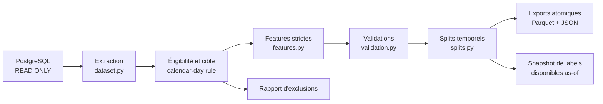

# Phase 5.2 — ML Dataset Construction & Temporal Validation

> **Statut : pipeline strict V1 implémenté, exécuté et validé — aucun modèle entraîné.**
>
> **Date d'exécution documentée : 18 novembre 2026.**

## Table des matières

1. [Présentation et objectifs](#section-1)
2. [Architecture du pipeline](#section-2)
3. [Sources PostgreSQL](#section-3)
4. [Population et construction de la cible](#section-4)
5. [Dataset strict V1](#section-5)
6. [Variables exclues et inventaire enrichi](#section-6)
7. [Granularité, jointures et validations](#section-7)
8. [Découpage temporel](#section-8)
9. [Politique de maturité des labels](#section-9)
10. [Contrat des features](#section-10)
11. [Exports et commandes](#section-11)
12. [Tests et résultats exécutés](#section-12)
13. [Limites et décisions restantes](#section-13)
14. [Préparation de la Phase 5.3](#section-14)

<a id="section-1"></a>

## 1. Présentation et objectifs

La Phase 5.1 a établi la définition de la cible, les risques de fuite et les incertitudes de disponibilité des données. La Phase 5.2 transforme cet audit en un pipeline reproductible de construction de dataset, sans entraîner de modèle.

Les objectifs implémentés sont :

- extraire PostgreSQL dans une transaction `READ ONLY` ;
- recalculer la cible selon la règle calendaire validée ;
- vérifier cette cible contre `dw.fact_orders.is_delayed` ;
- exclure explicitement les commandes sans cible observable ;
- produire une ligne unique par `order_id` ;
- construire uniquement les features strictes disponibles à la création ;
- séparer métadonnées, features contractuelles et cible ;
- créer des partitions chronologiques sans chevauchement ;
- filtrer les labels observables à une date de référence ;
- exporter des Parquet et des rapports JSON sans écrasement silencieux ;
- couvrir la logique par des tests synthétiques indépendants de PostgreSQL.

Le pipeline ne contient ni imputation statistique, ni encodage appris, ni normalisation, ni rééchantillonnage, ni modèle. Ces opérations devront être ajustées exclusivement sur le train pendant la Phase 5.3.

<a id="section-2"></a>

## 2. Architecture du pipeline



### 2.1 Organisation du code

| Fichier | Responsabilité |
|---|---|
| [`src/ml/contract.py`](../src/ml/contract.py) | Contrat versionné des neuf features, métadonnées et cible |
| [`src/ml/dataset.py`](../src/ml/dataset.py) | Connexion read-only, extraction, exclusions et cible |
| [`src/ml/features.py`](../src/ml/features.py) | Transformations déterministes de la V1 stricte |
| [`src/ml/validation.py`](../src/ml/validation.py) | Grain, schéma, cible, GPS et prévention des fuites |
| [`src/ml/splits.py`](../src/ml/splits.py) | Partitions chronologiques et filtre `as_of_date` |
| [`src/ml/build_dataset.py`](../src/ml/build_dataset.py) | Orchestration CLI, export atomique, rapports et hash |
| [`tests/ml/`](../tests/ml/) | Tests unitaires synthétiques sans dépendance PostgreSQL |

Chaque étape expose une fonction testable séparément. La CLI ne contient pas la logique métier : elle compose les fonctions d'extraction, de construction, de validation et d'export.

### 2.2 Principes de sécurité

- Les paramètres PostgreSQL sont lus depuis `.env` selon les conventions existantes.
- Aucune valeur de connexion n'est journalisée.
- La transaction exécute `SET TRANSACTION READ ONLY`.
- Les exports refusent les destinations existantes sauf option explicite `--overwrite`.
- Chaque fichier est d'abord écrit dans un temporaire du même répertoire, puis remplacé atomiquement.
- Les Parquet et JSON générés sont placés sous `data/processed/`, déjà exclu de Git.

<a id="section-3"></a>

## 3. Sources PostgreSQL

### 3.1 Sources réellement utilisées

La V1 stricte n'utilise que les trois objets nécessaires :

| Source | Colonnes extraites | Rôle |
|---|---|---|
| `dw.fact_orders` | Identifiant, statut, achat, livraison réelle, livraison estimée, cible DW | Grain, éligibilité, cible et contrôle de cohérence |
| `dw.dim_customer` | État, latitude, longitude, flag GPS | Features géographiques connues via l'adresse de livraison |
| `staging.orders_clean` | `flag_delivery_before_purchase` | Exclusion des anomalies temporelles invalidantes |

La requête effectue deux jointures plusieurs-vers-un sur des clés uniques : `customer_key` vers la dimension client et `order_id` vers le staging commandes. Elle ne joint aucun fait multi-ligne.

### 3.2 Sources volontairement non jointes

Les objets suivants ont été inspectés mais ne participent pas à la V1 stricte :

- `dw.fact_order_items` ;
- `dw.dim_product` ;
- `dw.dim_seller` ;
- paiements détaillés ou agrégés ;
- avis clients ;
- vues `analytics`.

Leur présence dans l'historique ne prouve pas qu'ils sont disponibles exactement à la création de la commande. Cette exclusion évite qu'un dataset techniquement riche soit présenté à tort comme reproductible en inférence.

<a id="section-4"></a>

## 4. Population et construction de la cible

### 4.1 Règle cible

La cible est recalculée en Python à partir des dates source :

```text
is_delayed = 1 si delivered_timestamp.date()
                  > estimated_delivery_timestamp.date()
             0 sinon
```

Elle n'est calculée qu'après validation des conditions d'éligibilité. La valeur `dw.fact_orders.is_delayed` n'est jamais utilisée pour construire la cible ; elle sert uniquement de contrôle de non-régression. Toute divergence provoque l'arrêt du pipeline.

### 4.2 Ordre des exclusions

Une commande reçoit au maximum un motif, selon la priorité suivante :

1. identifiant manquant ;
2. timestamp d'achat manquant ;
3. statut différent de `delivered` ;
4. date réelle de livraison manquante ;
5. date estimée manquante ;
6. livraison antérieure à l'achat ;
7. date estimée non postérieure au jour d'achat.

Une cible inconnue n'est jamais convertie en classe `0`.

### 4.3 Résultats réellement exécutés

| Indicateur | Résultat |
|---|---:|
| Commandes extraites | 99 441 |
| Commandes éligibles | 96 470 |
| Commandes exclues | 2 971 |
| Retards | 6 534 |
| Livraisons à temps | 89 936 |
| Taux de retard | 6,77 % |
| Doublons d'`order_id` | 0 |
| Divergences avec la cible DW | 0 |

Les exclusions constatées sont :

| Motif | Commandes |
|---|---:|
| Statut différent de `delivered` | 2 963 |
| Statut `delivered` sans date réelle | 8 |

Répartition des exclusions par statut :

| Statut | Commandes |
|---|---:|
| `approved` | 2 |
| `canceled` | 625 |
| `created` | 5 |
| `delivered` sans date | 8 |
| `invoiced` | 314 |
| `processing` | 301 |
| `shipped` | 1 107 |
| `unavailable` | 609 |

<a id="section-5"></a>

## 5. Dataset strict V1

### 5.1 Grain et structure

Chaque Parquet contient des lignes au grain :

```text
1 ligne = 1 order_id
```

Les colonnes sont organisées en trois groupes :

| Groupe | Colonnes | Utilisation |
|---|---|---|
| Métadonnées | `order_id`, `purchase_timestamp`, `label_observed_at` | Traçabilité, split et disponibilité du label |
| Features | Neuf colonnes définies par le contrat | Seules colonnes autorisées dans `X` |
| Cible | `is_delayed` | Uniquement `y` |

La fonction `model_matrix()` retourne seulement les neuf features. Les identifiants, timestamps bruts et la cible ne peuvent donc pas entrer implicitement dans la matrice modèle.

### 5.2 Features strictes

| Feature | Type | Transformation |
|---|---|---|
| `purchase_hour` | `int8` | Heure de 0 à 23 |
| `purchase_day_of_week` | `int8` | Lundi = 0, dimanche = 6 |
| `purchase_month` | `int8` | Mois de 1 à 12 |
| `purchase_quarter` | `int8` | Trimestre de 1 à 4 |
| `purchase_is_weekend` | `bool` | Samedi ou dimanche |
| `customer_state` | `string` | Code État nettoyé et mis en majuscules |
| `customer_latitude` | `Float64` nullable | Centroïde du préfixe postal si GPS valide |
| `customer_longitude` | `Float64` nullable | Centroïde du préfixe postal si GPS valide |
| `customer_has_gps` | `bool` | Vrai si flag et deux coordonnées valides |

Les coordonnées sont justifiées comme un lookup déterministe à partir du préfixe postal de l'adresse client disponible à la commande. Leur référentiel n'est cependant pas historisé ; cette limite devra être corrigée pour un système de production durable.

### 5.3 Valeurs manquantes

| Feature | Taux manquant exécuté |
|---|---:|
| `customer_latitude` | 0,274697 % |
| `customer_longitude` | 0,274697 % |
| Toutes les autres features | 0 % |

Les 265 commandes sans GPS restent dans le dataset avec `customer_has_gps = False`. Aucune moyenne, médiane ou valeur géographique artificielle n'est injectée à cette étape.

<a id="section-6"></a>

## 6. Variables exclues et inventaire enrichi

### 6.1 Colonnes interdites

Le validateur protège la liste de features contre les colonnes suivantes :

- `order_id`, timestamps bruts et `label_observed_at` ;
- statut final ;
- dates d'approbation, transporteur et livraison ;
- durée réelle et retard réel ;
- cible DW et cible recalculée ;
- notes et dates d'avis.

La date estimée n'est pas intégrée à la V1, conformément à la décision de Phase 5.1 : son moment exact de fixation n'est pas démontré par les données historiques.

### 6.2 Features enrichies préparées, non implémentées

| Domaine | Features envisagées | Condition préalable |
|---|---|---|
| Promesse | Délai promis, mois estimé | Confirmer que la date est fixée avant scoring |
| Panier | Articles, produits distincts, prix, fret, ratio de fret | Confirmer le contenu du payload de création |
| Vendeurs | Nombre, États, multivendeur, inter-État | Confirmer les vendeurs au moment du scoring |
| Distance | Minimum, moyenne et maximum client–vendeur | Même condition et référentiel GPS versionné |
| Produits | Catégories, poids, volume, flags qualité | Catalogue disponible et versionné au scoring |
| Paiements | Type, versements, méthodes | Confirmer la disponibilité avant approbation |
| Historiques | Activité client ou vendeur passée | Calcul as-of sur événements et labels déjà matures |

Aucun dataset enrichi n'est exporté dans cette phase. Cet inventaire ne constitue pas un contrat de production.

<a id="section-7"></a>

## 7. Granularité, jointures et validations

### 7.1 Invariants automatisés

Le pipeline vérifie :

- présence et unicité de `order_id` ;
- cible non nulle et appartenant à `{0, 1}` ;
- correspondance de la cible avec le Data Warehouse ;
- schéma et ordre exacts des colonnes ;
- absence de colonnes interdites dans les features ;
- cohérence entre coordonnées et `customer_has_gps` ;
- couverture complète et absence de chevauchement des splits ;
- ordre chronologique train → validation → test ;
- absence de ligne postérieure à la frontière finale configurée.

### 7.2 Prévention des produits cartésiens

La V1 ne joint qu'une dimension client et une table commandes de même cardinalité métier. Les faits articles, paiements et avis ne sont pas combinés.

Une future V2 enrichie devra obligatoirement :

1. agréger chaque source au grain `order_id` ;
2. valider l'unicité de chaque agrégat ;
3. joindre un agrégat à la fois ;
4. vérifier que le nombre de commandes reste inchangé après chaque jointure.

<a id="section-8"></a>

## 8. Découpage temporel

### 8.1 Frontières

Les frontières sont exclusives à droite :

```text
Train      : purchase_timestamp < 2018-01-01
Validation : 2018-01-01 <= purchase_timestamp < 2018-05-01
Test       : 2018-05-01 <= purchase_timestamp < 2018-09-01
```

### 8.2 Effectifs exécutés

| Partition | Lignes | Retards | À temps | Première commande | Dernière commande |
|---|---:|---:|---:|---|---|
| Train | 43 693 | 2 456 | 41 237 | 2016-09-15 12:16:38 | 2017-12-31 23:29:31 |
| Validation | 27 425 | 2 963 | 24 462 | 2018-01-01 02:48:41 | 2018-04-30 23:47:26 |
| Test | 25 352 | 1 115 | 24 237 | 2018-05-01 00:02:11 | 2018-08-29 15:00:37 |

Les trois ensembles couvrent exactement les 96 470 commandes, sans `order_id` commun. Le test final n'est utilisé par aucune transformation apprise dans cette phase.

### 8.3 Nature descriptive des splits complets

Ces partitions décrivent toutes les commandes dont le label est désormais connu. Elles ne signifient pas que chaque label était disponible à la date d'achat ou à la frontière du split. Cette distinction est gérée séparément par le mécanisme `as_of_date`.

<a id="section-9"></a>

## 9. Politique de maturité des labels

### 9.1 Règle implémentée

Le pipeline conserve :

```text
label_observed_at = delivered_timestamp
```

Pour une date de référence `T`, une ligne est utilisable pour un entraînement simulé uniquement si :

```text
label_observed_at < T
```

La comparaison est strictement antérieure. Une commande livrée exactement à `T` n'est pas considérée disponible juste avant cette coupure.

### 9.2 Exécution au 1er janvier 2018

L'exécution avec :

```text
as_of_date = 2018-01-01 00:00:00
```

produit **41 197 commandes** dont le label était déjà observable. Le train descriptif contient 43 693 commandes ; 2 496 commandes achetées avant la frontière n'avaient donc pas encore un label disponible à cet instant.

Ce snapshot `as_of` est distinct du train descriptif. Il constitue la population admissible pour simuler un entraînement effectué à cette date, sous réserve que les features historiques respectent la même borne temporelle.

### 9.3 Limite de censure

Filtrer sur les labels déjà observés favorise mécaniquement les commandes livrées plus rapidement près de la coupure. La Phase 5.3 devra comparer :

- le filtre exact `label_observed_at < as_of_date` ;
- une fenêtre de maturité fixe ;
- des folds purgés ou espacés ;
- la couverture et le taux de retard résultants.

<a id="section-10"></a>

## 10. Contrat des features

### 10.1 Version

Le contrat courant est :

```text
feature_schema_version = strict_v1.0.0
```

Il expose pour chaque feature :

- nom ;
- type attendu ;
- source SQL ;
- transformation ;
- disponibilité temporelle ;
- gestion des valeurs manquantes.

Le contrat est défini une seule fois dans [`contract.py`](../src/ml/contract.py), importable par un futur service FastAPI, puis exporté en JSON avec les datasets.

### 10.2 Compatibilité entraînement–inférence

Le futur service devra :

- produire exactement les neuf colonnes et types de la version demandée ;
- conserver `order_id` et les timestamps hors de `X` ;
- appliquer la même convention lundi = 0 ;
- normaliser `customer_state` de manière identique ;
- utiliser le même lookup GPS ou un référentiel explicitement versionné ;
- conserver les coordonnées manquantes avec le flag GPS ;
- refuser un schéma inconnu plutôt que réordonner silencieusement les champs.

<a id="section-11"></a>

## 11. Exports et commandes

### 11.1 Emplacement

Les artefacts sont écrits dans :

```text
data/processed/ml/
```

Ce répertoire est couvert par la règle `.gitignore` existante `data/processed/`.

### 11.2 Artefacts produits

| Fichier | Contenu exécuté |
|---|---|
| `strict_v1_supervised.parquet` | 96 470 lignes supervisées complètes |
| `strict_v1_train.parquet` | 43 693 lignes |
| `strict_v1_validation.parquet` | 27 425 lignes |
| `strict_v1_test.parquet` | 25 352 lignes |
| `strict_v1_labels_available_as_of_20180101T000000.parquet` | 41 197 labels matures |
| `strict_v1_feature_contract.json` | Contrat machine-readable |
| `strict_v1_exclusions_report.json` | Motifs et statuts exclus |
| `strict_v1_build_summary.json` | Volumes, classes, manquants, périodes et SHA-256 |

Les hash SHA-256 permettent de vérifier que les fichiers relus sont ceux produits par l'exécution documentée.

### 11.3 Exécution

Depuis la racine du repository, avec l'environnement virtuel actif :

```powershell
python -m src.ml.build_dataset --as-of-date "2018-01-01"
```

Choisir un autre répertoire :

```powershell
python -m src.ml.build_dataset `
  --output-dir "data/processed/ml_experiment" `
  --as-of-date "2018-01-01"
```

Si un artefact existe, l'exécution s'arrête. Son remplacement doit être demandé explicitement :

```powershell
python -m src.ml.build_dataset `
  --as-of-date "2018-01-01" `
  --overwrite
```

### 11.4 Tests

```powershell
python -m unittest discover -s tests/ml -p "test_*.py" -v
```

<a id="section-12"></a>

## 12. Tests et résultats exécutés

### 12.1 Tests unitaires

**Résultat : 8 tests réussis.**

Ils couvrent :

- règle calendaire de la cible ;
- livraison le jour estimé classée à temps ;
- commandes annulées et dates manquantes ;
- anomalie livraison avant achat ;
- reproductibilité des transformations ;
- coordonnées manquantes et flag GPS ;
- rejet des doublons ;
- absence d'identifiants, timestamps et cible dans `X` ;
- frontières exactes des splits ;
- couverture et absence de chevauchement ;
- filtre `as_of_date` sur la date d'observation du label ;
- export Parquet et JSON ;
- refus d'écrasement silencieux.

### 12.2 Compilation et CLI

- `compileall` sur `src/ml` et `tests/ml` : réussi.
- `python -m src.ml.build_dataset --help` : réussi.
- Pipeline PostgreSQL réel : réussi.

### 12.3 Relecture indépendante des artefacts

Les fichiers ont été relus depuis le disque après export. Les contrôles ont confirmé :

- 96 470 lignes et 96 470 identifiants uniques ;
- classes exactement `{0, 1}` ;
- 6 534 retards et 89 936 commandes à temps ;
- effectifs de partitions conformes ;
- aucun chevauchement ;
- couverture intégrale du dataset ;
- neuf features strictes ;
- aucune métadonnée dans la liste de features ;
- 41 197 labels strictement antérieurs au 1er janvier 2018 ;
- correspondance de tous les hash enregistrés.

### 12.4 Non-régression ETL

Le test d'intégration ETL existant a été réexécuté avec succès : dix Parquet présents, clés valides, six relations sans orphelin, réconciliations paiements et avis, et couvertures GPS conformes.

<a id="section-13"></a>

## 13. Limites et décisions restantes

- Le fuseau horaire des timestamps Olist n'est pas encodé. Le pipeline conserve les timestamps naïfs et exige une `as_of_date` naïve cohérente.
- Les coordonnées proviennent d'un référentiel statique non historisé.
- La V1 est volontairement peu riche : elle mesure une baseline honnête, pas la performance maximale possible.
- La date promise reste exclue tant que son ordre de calcul par rapport au scoring n'est pas confirmé.
- Les features panier, vendeur, produit et paiement restent hors contrat strict.
- La population supervisée ne contient que les commandes finalement livrées ; les annulations et indisponibilités nécessitent une politique séparée.
- Le filtre `as_of` peut introduire une censure des longues livraisons près de la coupure.
- Les splits fixes conviennent au dataset Olist actuel ; de nouvelles périodes postérieures au 1er septembre 2018 déclencheraient une erreur et exigeraient une configuration explicite.
- Le contrat contient des types de stockage, mais pas encore les encodeurs ou transformations apprises du futur pipeline modèle.

<a id="section-14"></a>

## 14. Préparation de la Phase 5.3

La Phase 5.3 pourra construire les premières baselines à partir de ce socle, après validation utilisateur. Elle devra :

1. charger les Parquet sans reconstruire les splits ;
2. utiliser exclusivement la liste contractuelle pour `X` ;
3. ajuster encodage et imputation sur le train ou le fold courant ;
4. comparer train descriptif et population réellement mature as-of ;
5. conserver le test final scellé pendant la sélection ;
6. commencer par une baseline de prévalence et une régression logistique ;
7. évaluer PR-AUC, recall, precision, F1, calibration et stabilité temporelle ;
8. documenter la performance par mois, État et couverture GPS ;
9. choisir les dépendances ML explicitement avant de modifier `requirements.txt` ;
10. ne pas ajouter les features enrichies avant validation de leur contrat opérationnel.

## Conclusion

La Phase 5.2 fournit un pipeline de données ML versionnable, déterministe et contrôlé. Les 96 470 commandes éligibles sont séparées sans chevauchement, les labels inconnus restent exclus, les métadonnées ne contaminent pas la matrice de features et la disponibilité réelle des labels peut être simulée à une date donnée.

Le résultat constitue une base fiable pour évaluer des modèles en Phase 5.3, sans présenter des données historiques incertaines comme disponibles en production.

**Statut final : Phase 5.2 implémentée et validée ; aucun modèle entraîné.**
