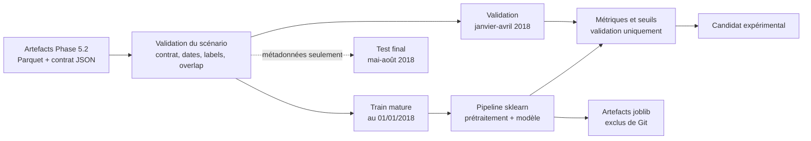

# Phase 5.3 — Machine Learning Training & Model Evaluation

> **Statut : première comparaison temporelle exécutée et validée sur la validation uniquement.**
>
> **Le modèle retenu est un candidat expérimental, pas un modèle prêt pour la production. Le test final n'a pas été évalué.**
>
> **Date d'exécution documentée : 18 novembre 2026.**

## Table des matières

1. [Objectif et périmètre](#section-1)
2. [Architecture d'entraînement](#section-2)
3. [Contrat de features et prévention des fuites](#section-3)
4. [Stratégie temporelle](#section-4)
5. [Prétraitement](#section-5)
6. [Modèles comparés](#section-6)
7. [Résultats de validation](#section-7)
8. [Seuil candidat et analyse des erreurs](#section-8)
9. [Robustesse et interprétabilité](#section-9)
10. [Artefacts et reproductibilité](#section-10)
11. [Tests et contrôles exécutés](#section-11)
12. [Limites et risques](#section-12)
13. [Préparation de l'étape suivante](#section-13)

<a id="section-1"></a>

## 1. Objectif et périmètre

Cette phase implémente un premier pipeline reproductible de prétraitement, d'entraînement et de comparaison pour la prédiction d'un retard de livraison. Elle prolonge le contrat de données `strict_v1.0.0` produit en Phase 5.2 sans reconstruire les datasets sources.

Le périmètre réalisé comprend :

- le chargement et la validation des partitions Parquet existantes ;
- l'entraînement de quatre familles de modèles avec des pipelines scikit-learn complets ;
- l'évaluation sur la validation chronologique de janvier à avril 2018 ;
- la comparaison de seuils sur cette validation uniquement ;
- l'analyse mensuelle, régionale, de calibration et d'importance des variables ;
- une ablation optionnelle des coordonnées GPS ;
- la sérialisation contrôlée des pipelines et des rapports de résultats.

Cette phase n'inclut ni recherche exhaustive d'hyperparamètres, ni évaluation finale, ni déploiement, ni API. Le fichier test est chargé uniquement pour valider son schéma, ses bornes temporelles et l'absence de chevauchement d'identifiants. Il n'est passé à aucun modèle.

<a id="section-2"></a>

## 2. Architecture d'entraînement



### 2.1 Organisation du code

| Fichier | Responsabilité |
|---|---|
| [`src/ml/training.py`](../src/ml/training.py) | Configuration temporelle, chargement, contrôles, préprocesseurs et définitions des modèles |
| [`src/ml/evaluation.py`](../src/ml/evaluation.py) | Métriques, seuils, calibration, sous-groupes et importance des variables |
| [`src/ml/train_models.py`](../src/ml/train_models.py) | Orchestration CLI, sélection du candidat et sauvegarde atomique des artefacts |
| [`tests/ml/test_training.py`](../tests/ml/test_training.py) | Entraînement synthétique, inconnues, reproductibilité, isolation et sérialisation |
| [`tests/ml/test_evaluation.py`](../tests/ml/test_evaluation.py) | Métriques, matrice de confusion, seuil et calibration |

Le scénario par défaut est nommé `historical_as_of_20180101`. La graine aléatoire est fixée à `42`. Les sorties ne sont pas écrasées silencieusement : une nouvelle exécution sur le même dossier exige `--overwrite`.

<a id="section-3"></a>

## 3. Contrat de features et prévention des fuites

Le pipeline utilise exactement, dans l'ordre contractuel, les neuf variables autorisées :

1. `purchase_hour`
2. `purchase_day_of_week`
3. `purchase_month`
4. `purchase_quarter`
5. `purchase_is_weekend`
6. `customer_state`
7. `customer_latitude`
8. `customer_longitude`
9. `customer_has_gps`

La cible est `is_delayed`. La matrice d'entrée exclut les identifiants, timestamps bruts, informations de livraison futures et toute variable dérivée de la cible. Le code vérifie que la version du contrat est `strict_v1.0.0` ainsi que l'égalité exacte de la liste et de l'ordre des features entre le JSON et le code Python.

Les garanties appliquées avant l'entraînement sont :

- chaque dataset respecte le contrat strict et contient une cible binaire ;
- tous les labels du train sont observables strictement avant le `2018-01-01` ;
- toutes les commandes du train précèdent cette date ;
- la validation appartient à `[2018-01-01, 2018-05-01[` ;
- le test appartient à `[2018-05-01, 2018-09-01[` ;
- aucun `order_id` ne se chevauche entre train, validation et test ;
- chaque préprocesseur est ajusté par son `Pipeline` sur le train uniquement.

<a id="section-4"></a>

## 4. Stratégie temporelle

### 4.1 Partitions réellement utilisées

| Partition | Usage dans cette phase | Lignes | À l'heure | En retard | Taux de retard |
|---|---|---:|---:|---:|---:|
| Train mature au 01/01/2018 | Ajustement des préprocesseurs et modèles | 41 197 | 39 432 | 1 765 | 4,2843 % |
| Validation janvier-avril 2018 | Métriques, sélection et seuil | 27 425 | 24 462 | 2 963 | 10,8040 % |
| Test mai-août 2018 | Contrat, dates et overlap uniquement | 25 352 | Non évalué | Non évalué | Non évalué |

Le train descriptif de 43 693 lignes n'est pas utilisé directement. Seules les 41 197 commandes dont le label était déjà observable à la date de référence sont admises.

Les labels de validation sont utilisés rétrospectivement pour mesurer la performance après leur observation. Ils ne participent ni à l'ajustement du prétraitement, ni à l'entraînement. Le test final ne participe à aucune décision de modèle, seuil, feature ou hyperparamètre.

### 4.2 Déséquilibre et dérive

La prévalence du retard passe de 4,28 % dans le train à 10,80 % dans la validation. Cette différence affecte directement la précision, l'Average Precision et la calibration. Elle justifie une lecture conjointe des métriques de classement, des matrices de confusion et des résultats mensuels plutôt qu'un critère fondé sur l'accuracy.

<a id="section-5"></a>

## 5. Prétraitement

Chaque modèle est encapsulé avec son propre `ColumnTransformer` dans un `Pipeline` :

- **numériques** : imputation médiane apprise sur le train ; `StandardScaler` uniquement pour la régression logistique ;
- **catégorielles** : imputation par la modalité la plus fréquente, puis `OneHotEncoder(handle_unknown="ignore")` ;
- **booléennes** : conversion déterministe en `0.0`/`1.0`, puis imputation de la valeur la plus fréquente ;
- **sortie dense** : activée explicitement pour `HistGradientBoostingClassifier` ;
- **sortie sparse compatible** : conservée pour les autres modèles lorsque possible.

Chaque construction clone l'estimateur de sa définition. Cette isolation empêche une expérience secondaire, comme l'ablation GPS, de réajuster par inadvertance le classifieur d'un pipeline déjà entraîné.

<a id="section-6"></a>

## 6. Modèles comparés

| Modèle | Configuration principale | Traitement du déséquilibre |
|---|---|---|
| `DummyClassifier` | stratégie `prior` | baseline de prévalence |
| `LogisticRegression` | `lbfgs`, `max_iter=1000`, seed 42 | `class_weight="balanced"` |
| `RandomForestClassifier` | 250 arbres, profondeur 12, feuille min. 10, seed 42 | `balanced_subsample` |
| `HistGradientBoostingClassifier` | learning rate 0,05, 150 itérations, 31 feuilles, L2=1, seed 42 | `class_weight="balanced"` |

Aucune recherche exhaustive n'a été exécutée. Ces configurations bornées constituent une première comparaison, pas un tuning définitif.

<a id="section-7"></a>

## 7. Résultats de validation

La convention **PR-AUC** utilisée ici est exactement `average_precision_score`. Elle ne correspond pas à une intégration trapézoïdale de la courbe précision-rappel.

### 7.1 Comparaison au seuil de référence 0,5

| Modèle | Average Precision | ROC-AUC | Précision retard | Rappel retard | F1 | Balanced accuracy | Brier | Prédictions positives |
|---|---:|---:|---:|---:|---:|---:|---:|---:|
| Dummy | 0,1080 | 0,5000 | 0,0000 | 0,0000 | 0,0000 | 0,5000 | **0,1006** | 0,00 % |
| Régression logistique | **0,1533** | **0,5869** | **0,1921** | **0,4603** | **0,2710** | **0,6129** | 0,1973 | 25,90 % |
| Random Forest | 0,1439 | 0,5561 | 0,1782 | 0,1542 | 0,1653 | 0,5340 | **0,1725** | 9,35 % |
| HistGradientBoosting | 0,1452 | 0,5688 | 0,1480 | 0,2950 | 0,1971 | 0,5446 | 0,1889 | 21,54 % |

La régression logistique obtient le meilleur classement global sur validation selon l'Average Precision, la ROC-AUC, le F1 et la balanced accuracy. La PR-AUC reste cependant faible en valeur absolue. Son Brier score élevé indique que ses probabilités ne doivent pas être interprétées comme des probabilités calibrées.

### 7.2 Matrices de confusion au seuil 0,5

La classe positive est « en retard ».

| Modèle | TN | FP | FN | TP |
|---|---:|---:|---:|---:|
| Dummy | 24 462 | 0 | 2 963 | 0 |
| Régression logistique | 18 724 | 5 738 | 1 599 | 1 364 |
| Random Forest | 22 354 | 2 108 | 2 506 | 457 |
| HistGradientBoosting | 19 429 | 5 033 | 2 089 | 874 |

### 7.3 Écart train-validation

| Modèle | AP train | AP validation | Lecture prudente |
|---|---:|---:|---|
| Dummy | 0,0428 | 0,1080 | reflète la différence de prévalence |
| Régression logistique | 0,0806 | 0,1533 | AP non directement comparable avec une prévalence différente |
| Random Forest | 0,2812 | 0,1439 | écart important, compatible avec surapprentissage et dérive |
| HistGradientBoosting | 0,2170 | 0,1452 | écart important, compatible avec surapprentissage et dérive |

L'Average Precision dépend de la prévalence. Ces écarts ne doivent donc pas être interprétés isolément, mais ils renforcent la nécessité d'une validation temporelle et d'un contrôle de stabilité.

<a id="section-8"></a>

## 8. Seuil candidat et analyse des erreurs

### 8.1 Règle de sélection

La politique choisit d'abord la meilleure Average Precision de validation. Si plusieurs modèles non triviaux sont à moins de `0,005` en valeur absolue, elle privilégie le plus simple. Avec une AP maximale de `0,153258`, seule la régression logistique reste dans cette tolérance ; elle est donc retenue comme candidat expérimental.

### 8.2 Seuil candidat

Le seuil `0,459566` maximise le F1 sur la validation. Aucun coût métier n'étant disponible, cette optimisation est seulement une proposition technique. Le seuil de référence `0,5` reste conservé dans les rapports.

| Mesure au seuil candidat | Valeur |
|---|---:|
| Average Precision | 0,1533 |
| ROC-AUC | 0,5869 |
| Précision retard | 0,1963 |
| Rappel retard | 0,5231 |
| F1 | 0,2855 |
| Balanced accuracy | 0,6318 |
| Brier score | 0,1973 |
| Taux de prédictions positives | 28,79 % |

Matrice de confusion au seuil candidat :

| TN | FP | FN | TP |
|---:|---:|---:|---:|
| 18 115 | 6 347 | 1 413 | 1 550 |

L'abaissement du seuil récupère 186 retards supplémentaires par rapport au seuil 0,5, au prix de 609 faux positifs supplémentaires. Sans coût métier des faux négatifs et faux positifs, il n'est pas possible d'affirmer que ce compromis est optimal opérationnellement.

<a id="section-9"></a>

## 9. Robustesse et interprétabilité

### 9.1 Performance mensuelle du candidat

| Mois | Lignes | Taux retard | AP | Précision | Rappel | F1 | TN | FP | FN | TP |
|---|---:|---:|---:|---:|---:|---:|---:|---:|---:|---:|
| 2018-01 | 7 069 | 5,70 % | 0,1008 | 0,1070 | 0,5484 | 0,1791 | 4 822 | 1 844 | 182 | 221 |
| 2018-02 | 6 555 | 14,13 % | 0,2260 | 0,2660 | 0,5572 | 0,3601 | 4 205 | 1 424 | 410 | 516 |
| 2018-03 | 7 003 | 18,96 % | 0,2718 | 0,3211 | 0,4556 | 0,3767 | 4 396 | 1 279 | 723 | 605 |
| 2018-04 | 6 798 | 4,50 % | 0,1376 | 0,1036 | 0,6797 | 0,1798 | 4 692 | 1 800 | 98 | 208 |

Les résultats varient fortement avec le mois et la prévalence. Mars présente la meilleure précision et le meilleur F1, tandis que janvier et avril génèrent beaucoup de faux positifs. Cette instabilité empêche de considérer le seuil comme définitivement validé.

### 9.2 Performance par État client

Seuls les États comportant au moins 500 lignes de validation sont inclus.

| État | Lignes | Taux retard | AP | Précision | Rappel | F1 |
|---|---:|---:|---:|---:|---:|---:|
| BA | 887 | 19,05 % | 0,1807 | 0,1905 | 1,0000 | 0,3201 |
| DF | 598 | 9,03 % | 0,0662 | 0,0000 | 0,0000 | 0,0000 |
| ES | 567 | 19,22 % | 0,1538 | 0,1922 | 1,0000 | 0,3225 |
| GO | 563 | 11,37 % | 0,0868 | 0,0526 | 0,0312 | 0,0392 |
| MG | 3 270 | 8,75 % | 0,0594 | 0,0000 | 0,0000 | 0,0000 |
| PR | 1 456 | 6,18 % | 0,0411 | 0,0000 | 0,0000 | 0,0000 |
| RJ | 3 400 | 21,97 % | 0,1590 | 0,2186 | 0,9893 | 0,3581 |
| RS | 1 482 | 11,34 % | 0,0901 | 0,0000 | 0,0000 | 0,0000 |
| SC | 1 057 | 13,72 % | 0,1037 | 0,1377 | 1,0000 | 0,2421 |
| SP | 11 580 | 5,41 % | 0,0408 | 0,0000 | 0,0000 | 0,0000 |

Au seuil global, certaines régions ont un rappel nul et d'autres presque total. Ce comportement montre une forte dépendance aux indicatrices d'État et un risque d'hétérogénéité géographique. Ces associations ne prouvent aucune causalité.

### 9.3 Calibration

Les dix groupes de calibration du candidat ont des probabilités moyennes comprises entre `0,267` et `0,633`, pour des taux observés compris entre `0,035` et `0,230`. L'ordre n'est pas monotone sur tous les groupes. Le `class_weight="balanced"` améliore le compromis de classement mais déforme les probabilités brutes ; aucune décision fondée sur une probabilité métier ne doit être prise sans calibration temporelle séparée.

### 9.4 Importance des variables

Pour la régression logistique, les plus grands coefficients absolus concernent principalement certaines modalités de `customer_state`, puis `purchase_quarter`, `purchase_month` et les coordonnées. Pour le Random Forest, les premières importances sont `purchase_month`, `customer_longitude`, `customer_latitude`, `purchase_hour`, `purchase_quarter` et `purchase_day_of_week`.

Ces importances sont spécifiques au modèle, corrélées entre elles et non causales. Les coefficients des modalités rares doivent être interprétés avec une prudence particulière.

### 9.5 Ablation GPS

La régression logistique sans `customer_latitude`, `customer_longitude` et `customer_has_gps` atteint une AP de `0,152436`, contre `0,153258` avec ces variables, soit une différence de seulement `0,000822`. Son meilleur F1 est `0,2865`, très proche du pipeline complet (`0,2855`).

Cette première ablation ne met pas en évidence de dépendance substantielle aux coordonnées GPS non historisées. Elle ne suffit toutefois pas à démontrer leur innocuité dans tous les scénarios temporels.

<a id="section-10"></a>

## 10. Artefacts et reproductibilité

Les sorties sont enregistrées sous :

`models/delivery_delay/strict_v1/historical_as_of_20180101/`

Ce répertoire est exclu de Git. Les fichiers `joblib` produits localement sont considérés comme fiables uniquement parce qu'ils ont été créés par cette exécution ; un fichier `joblib` provenant d'une source inconnue ne doit jamais être chargé.

### 10.1 Pipelines

- `dummy_classifier.joblib`
- `logistic_regression.joblib`
- `random_forest.joblib`
- `hist_gradient_boosting.joblib`

### 10.2 Rapports

- `training_config.json` : scénario, features, distributions, paramètres, versions et hash des entrées ;
- `validation_metrics.json` : métriques train et validation, seuil 0,5 et meilleur F1 ;
- `threshold_analysis.json` : diagnostics de seuils pour chaque modèle ;
- `robustness_analysis.json` : mois, États, calibration et ablation GPS ;
- `feature_importance.json` : coefficients ou importances disponibles ;
- `selected_candidate.json` : règle de choix, modèle, seuil et statut non production ;
- `artifact_manifest.json` : taille et SHA-256 de chaque artefact.

Versions de l'exécution : Python `3.12.10`, NumPy `2.5.4`, pandas `3.1.1`, scikit-learn `1.9.1`, SciPy `1.18.1` et joblib `1.6.0`.

### 10.3 Commande de reproduction

```powershell
.\.venv\Scripts\python.exe -m src.ml.train_models --run-gps-ablation
```

Pour régénérer volontairement un dossier déjà peuplé :

```powershell
.\.venv\Scripts\python.exe -m src.ml.train_models --run-gps-ablation --overwrite
```

<a id="section-11"></a>

## 11. Tests et contrôles exécutés

La suite ML contient 16 tests unitaires réussis. Elle couvre notamment :

- le contrat et l'ordre exact des features ;
- l'absence de colonnes de fuite dans la matrice modèle ;
- le filtre de maturité des labels ;
- les bornes et l'absence de chevauchement temporel ;
- l'imputation des valeurs manquantes ;
- les catégories inconnues non apprises depuis la validation ;
- l'entraînement des quatre modèles sur données synthétiques ;
- les probabilités finies comprises entre 0 et 1 ;
- la reproductibilité du Random Forest ;
- la sauvegarde et le rechargement d'un pipeline fiable ;
- l'isolation de l'ablation par rapport au pipeline complet ;
- les métriques, matrices de confusion, seuils et groupes de calibration.

Contrôles supplémentaires réalisés sur les artefacts réels :

- rechargement réussi des quatre pipelines générés ;
- égalité de l'ordre des neuf features après rechargement ;
- reproduction exacte des métriques enregistrées sur les 27 425 lignes de validation ;
- vérification de toutes les tailles et empreintes SHA-256 du manifeste ;
- confirmation qu'aucune prédiction n'a été exécutée sur le test final.

Les neuf scripts historiques de transformation et d'intégration ETL ont également été exécutés comme modules Python et ont tous réussi. Ce contrôle confirme notamment les dimensions, les clés, l'intégrité référentielle et les totaux financiers existants, sans reconstruire ni modifier les données.

<a id="section-12"></a>

## 12. Limites et risques

1. **Signal prédictif faible.** Une AP de 0,1533 dépasse la baseline de 0,1080, mais reste insuffisante pour revendiquer une performance opérationnelle robuste.
2. **Dérive temporelle.** La prévalence et les performances changent fortement entre le train et les mois de validation.
3. **Calibration insuffisante.** Les probabilités pondérées sont éloignées des fréquences observées ; le candidat est un score de classement, pas une probabilité métier calibrée.
4. **Hétérogénéité régionale.** Le rappel varie de 0 à presque 1 selon les États les plus représentés.
5. **Features strictes limitées.** Le scénario de disponibilité à la création de commande exclut de nombreux prédicteurs potentiels ; tout enrichissement devra prouver sa disponibilité historique et l'absence de fuite.
6. **GPS non historisé.** L'ablation est rassurante pour ce scénario, mais le référentiel reste une limite de gouvernance.
7. **Seuil sans coût métier.** Le seuil maximisant le F1 ne représente pas nécessairement le compromis économique attendu.
8. **Test final encore intact.** Aucun résultat de généralisation finale n'est disponible à ce stade, conformément au protocole.

<a id="section-13"></a>

## 13. Préparation de l'étape suivante

Après validation explicite de cette phase, l'étape suivante pourra :

- figer le pipeline candidat et le seuil à évaluer ;
- définir, si possible, le coût métier des faux positifs et faux négatifs ;
- décider si une calibration doit être ajustée sur une fenêtre temporelle distincte ;
- exécuter une seule évaluation finale sur le test de mai à août 2018 ;
- documenter sans réajustement les métriques finales et les écarts temporels ;
- décider ensuite, selon les résultats, d'abandonner, d'enrichir ou d'industrialiser le candidat.

Aucune de ces actions, et notamment aucune évaluation du test final, n'est réalisée dans la présente phase.
