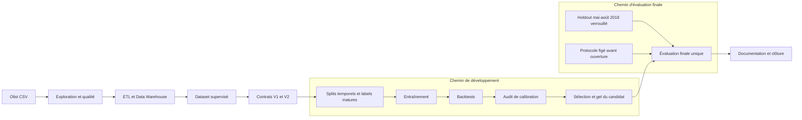

# Phase 5 — Machine Learning pour la prédiction des retards de livraison

> **Statut de clôture documentaire**
>
> - **Experimental Evaluation: GO**
> - **Generalization: NO-GO**
> - **Production Readiness: NO-GO**
>
> Ces décisions évaluent trois niveaux distincts : la validité de l'expérience, la qualité de généralisation du candidat et son aptitude à un usage opérationnel.

## 1. Executive Summary

La Phase 5 étudie la possibilité de classer, dès la création d'une commande Olist, les commandes susceptibles d'être livrées après la date promise. Le cas d'usage potentiel est un mécanisme de priorisation : une capacité d'intervention limitée pourrait être concentrée sur les commandes les plus risquées. Aucun coût métier, bénéfice financier ou budget opérationnel n'étant disponible, le projet n'attribue pas de valeur économique aux alertes et n'automatise aucune décision.

Le travail part des 99 441 commandes historiques du Data Warehouse. Une population supervisée de 96 470 commandes finalement livrées et évaluables a été constituée : 89 936 livraisons à temps, 6 534 retards et 2 971 commandes exclues. La cible compare les dates calendaires de livraison réelle et promise. La date de connaissance du label est conservée séparément afin d'éviter d'entraîner un modèle avec un résultat qui n'était pas encore observable à la date simulée.

Deux contrats ont été étudiés. `strict_v1.0.0` contient neuf features dont la disponibilité à la création est défendable. `enriched_v2.0.0` ajoute dix-neuf features de promesse, panier, vendeur, distance et produit ; ces enrichissements restent conditionnels, car leur disponibilité exacte au moment du scoring n'est pas certifiée. V2 ne peut donc pas remplacer V1 dans un scénario opérationnel validé.

Les expériences utilisent exclusivement des séparations temporelles. Quatre familles de modèles ont d'abord été comparées. La régression logistique V1 a obtenu la meilleure Average Precision de validation de la Phase 5.3 (`0,153258`). Les travaux suivants ont étudié V2, la calibration et des backtests mensuels. Un audit a découvert qu'une calibration sigmoid scikit-learn pouvait devenir décroissante et inverser intégralement le classement. La procédure a été corrigée et versionnée ; une campagne finale de développement a ensuite figé un candidat V1 brut, sans calibration, associé à une politique Top 10 % par lot mensuel.

Le candidat final `strict_v1_logistic_top10_v1` est une `LogisticRegression` pondérée, entraînée sur 47 794 commandes dont 2 387 retards. Son évaluation finale unique sur 25 352 commandes de mai à août 2018 donne une AP de `0,052363`, une ROC-AUC de `0,561720` et un lift Top 10 % de `1,4788`. Les performances sont instables : en août, le lift tombe à `0,7369`, sous le niveau d'une sélection aléatoire de même taille. Les scores sont fortement non calibrés et le drift de score est élevé.

La procédure finale est techniquement valide : candidat, protocole, lecture unique d'évaluation, hashes et règle d'arrêt sont traçables. La généralisation est toutefois insuffisante et le modèle n'est pas prêt pour la production. Le holdout est verrouillé ; aucune nouvelle évaluation, optimisation, calibration ou sélection ne peut être effectuée sur cette population.

## 2. Contexte et problématique métier

Un retard peut dégrader l'expérience client, accroître la charge de support et nécessiter une intervention logistique. Le projet cherche donc à estimer un **rang de risque** dès la création de la commande, et non à expliquer causalement les retards.

Les usages analytiques envisageables sont :

- étudier les variations temporelles et géographiques du risque ;
- simuler une liste bornée de commandes à examiner ;
- comparer les performances historiques de différentes politiques d'alerte ;
- exposer, avec un statut expérimental explicite, les métadonnées et résultats des expériences.

Une fausse alerte mobiliserait une capacité sans retard réel ; un retard manqué resterait sans intervention. Leur coût relatif n'est pas connu. Aucun seuil ou budget ne peut donc être déclaré optimal. La population supervisée est par ailleurs conditionnelle aux commandes finalement livrées : elle ne couvre pas directement les commandes annulées ou indisponibles reçues par un éventuel système réel.

## 3. Architecture de la Phase 5



Le chemin de développement s'arrête au gel du candidat. Le holdout ne sert ni à choisir les features, ni à entraîner, calibrer ou sélectionner un seuil. La documentation finale conserve cette séparation.

## 4. Dataset et qualité des données

### 4.1 Populations de référence

| Population | Commandes | À temps | Retards | Usage |
|---|---:|---:|---:|---|
| Historique Data Warehouse | 99 441 | — | — | Population source |
| Supervisée éligible | 96 470 | 89 936 | 6 534 | Dataset complet labellisé |
| Exclue | 2 971 | — | — | Cible inconnue ou non admissible |

Les 2 971 exclusions comprennent 2 963 commandes dont le statut n'est pas `delivered` et huit commandes déclarées livrées sans date réelle de livraison. Une cible inconnue n'est jamais convertie en classe négative.

### 4.2 Critères d'éligibilité

Une commande supervisée doit avoir :

- un `order_id` et un timestamp d'achat valides ;
- le statut `delivered` ;
- une date de livraison réelle ;
- une date de livraison estimée ;
- aucune livraison antérieure à l'achat ;
- une promesse strictement postérieure au jour d'achat ;
- une cible binaire cohérente avec le Data Warehouse.

Le grain est toujours `1 ligne = 1 order_id`. Les sources multi-lignes, lorsqu'elles sont utilisées expérimentalement en V2, sont agrégées et validées avant jointure.

### 4.3 Anomalies pertinentes

Les audits amont ont identifié huit commandes livrées sans date de livraison, six commandes annulées avec une date de livraison, 814 occurrences supplémentaires de `review_id` dupliqués réparties sur 1 603 lignes et 547 commandes avec plusieurs avis. La clé composite `(review_id, order_id)` reste unique : la multiplicité des avis est conservée comme événement métier. Les six relations principales testées n'ont aucun identifiant orphelin. La géolocalisation contient aussi de nombreux doublons exacts, traités dans l'ETL avant l'enrichissement.

Ces constats motivent les validations de cible, de grain et de jointure. Aucun effet causal sur les performances ML n'est revendiqué.

Sources : [Phase 5.1](PHASE_5_1_ML_DATA_AUDIT.md), [Phase 5.2](PHASE_5_2_ML_DATASET.md).

## 5. Définition de la cible

La cible est :

```text
is_delayed = 1 si delivered_timestamp.date()
                  > estimated_delivery_timestamp.date()
             0 sinon
```

Une livraison effectuée le jour promis est à temps, quelle que soit l'heure. Cette règle calendaire est cohérente avec le Data Warehouse et évite qu'une comparaison des timestamps complets change la sémantique métier.

Trois instants doivent être distingués :

- `purchase_timestamp` : création et instant de scoring simulé ;
- `estimated_delivery_timestamp` : promesse nécessaire à la définition de la cible, mais non utilisée dans V1 comme feature ;
- `label_observed_at = delivered_timestamp` : instant auquel le résultat devient connaissable.

Pour une origine temporelle `T`, une ligne n'est admissible dans l'historique d'entraînement que si son achat **et** son label sont strictement antérieurs à `T`. Sans cette règle, les longues livraisons proches de la coupure introduiraient des résultats futurs dans le passé simulé. Le filtrage des labels matures peut lui-même censurer les longues livraisons ; cette limite est suivie explicitement.

## 6. Feature Engineering

### 6.1 Strict V1

Version : `strict_v1.0.0`. Les neuf variables sont disponibles ou calculables à la création sous les hypothèses documentées.

| Feature | Type | Origine | Disponibilité | Prétraitement modèle |
|---|---|---|---|---|
| `purchase_hour` | `int8` | `dw.fact_orders.purchase_timestamp` | Création | Médiane ; standardisation pour Logistic |
| `purchase_day_of_week` | `int8` | Timestamp d'achat | Création | Médiane ; standardisation pour Logistic |
| `purchase_month` | `int8` | Timestamp d'achat | Création | Médiane ; standardisation pour Logistic |
| `purchase_quarter` | `int8` | Timestamp d'achat | Création | Médiane ; standardisation pour Logistic |
| `purchase_is_weekend` | `bool` | Timestamp d'achat | Création | Conversion 0/1 ; modalité fréquente |
| `customer_state` | `string` | `dw.dim_customer.customer_state` | Adresse de livraison | Modalité fréquente ; one-hot, inconnues ignorées |
| `customer_latitude` | `Float64` | Centroïde GPS client | Lookup déterministe, référentiel statique | Médiane ; standardisation pour Logistic |
| `customer_longitude` | `Float64` | Centroïde GPS client | Lookup déterministe, référentiel statique | Médiane ; standardisation pour Logistic |
| `customer_has_gps` | `bool` | Flag et coordonnées client | Lookup déterministe | Conversion 0/1 ; modalité fréquente |

Les coordonnées absentes restent nulles dans le dataset, avec un flag explicite. L'imputation est apprise uniquement dans le pipeline du train.

### 6.2 Enriched V2

Version : `enriched_v2.0.0`, statut `conditional_not_production_validated`. V2 conserve les neuf variables V1 et ajoute dix-neuf enrichissements, pour un total de 28 features.

| Feature ajoutée | Type | Origine / transformation | Risque de disponibilité | Prétraitement |
|---|---|---|---|---|
| `promised_delivery_days` | `int16` | Écart calendaire promesse–achat | Date de fixation non horodatée | Numérique |
| `item_count` | `int16` | Nombre de lignes article | Payload checkout non prouvé | Numérique |
| `total_item_value` | `float64` | Somme des prix | Payload non prouvé | Numérique |
| `total_freight_value` | `float64` | Somme du fret | Payload non prouvé | Numérique |
| `freight_ratio` | `float64` | Fret / valeur articles | Même risque que ses sources | Numérique |
| `seller_count` | `int16` | Vendeurs distincts | Allocation au scoring non prouvée | Numérique |
| `seller_state_count` | `int16` | États vendeur distincts | Même risque vendeur | Numérique |
| `is_multi_seller` | `bool` | `seller_count > 1` | Même risque vendeur | Booléen |
| `distance_km_mean` | `Float64` | Haversine moyenne | Vendeurs et GPS statiques | Numérique |
| `distance_km_max` | `Float64` | Haversine maximale | Même risque distance | Numérique |
| `distance_km_weighted_by_item_value` | `Float64` | Haversine pondérée par prix | Distance et prix non prouvés | Numérique |
| `distance_coverage_ratio` | `float64` | Routes GPS valides / articles | Même risque distance | Numérique |
| `distance_incomplete` | `bool` | Couverture distance < 1 | Même risque distance | Booléen |
| `category_count` | `int16` | Catégories distinctes | Catalogue non historisé | Numérique |
| `dominant_category` | `string` | Prix, puis volume, puis ordre lexical | Catalogue non historisé | Catégoriel |
| `total_product_weight_g` | `Float64` | Somme des poids | Catalogue non historisé | Numérique |
| `total_product_volume_cm3` | `Float64` | Somme longueur × hauteur × largeur | Catalogue non historisé | Numérique |
| `product_physical_coverage_ratio` | `float64` | Articles physiques complets / articles | Même risque catalogue | Numérique |
| `product_physical_incomplete` | `bool` | Couverture physique < 1 | Même risque catalogue | Booléen |

Les numériques suivent une imputation médiane et, pour la régression logistique, une standardisation. Les catégorielles utilisent l'imputation la plus fréquente et un one-hot tolérant les catégories inconnues. Les booléennes sont converties en nombres puis imputées par la valeur la plus fréquente.

Les dix-neuf ajouts ne sont **pas** certifiés disponibles au moment du scoring. Leurs gains expérimentaux ne valident pas leur usage opérationnel.

## 7. Stratégie temporelle

Le split aléatoire mélangerait des régimes de prévalence différents, exposerait indirectement des catégories et distributions futures et ne simulerait pas un déploiement vers une période ultérieure. La validation principale est donc chronologique.

### 7.1 Découpage descriptif complet

| Partition | Achat | Lignes | Retards | Rôle |
|---|---|---:|---:|---|
| Train descriptif | avant 2018-01-01 | 43 693 | 2 456 | Population historique complète |
| Validation | janvier–avril 2018 | 27 425 | 2 963 | Développement pré-holdout |
| Holdout | mai–août 2018 | 25 352 | 1 115 | Évaluation finale unique |

### 7.2 Découpages propres aux expériences

- **Phase 5.3** : 41 197 labels matures au 1er janvier 2018 pour l'entraînement, puis validation janvier–avril.
- **Phase 5.4** : folds mensuels avec train antérieur, calibration sur les deux mois précédents et évaluation sur le mois suivant.
- **Phase 5.4.2** : train, un mois pour calibrer, un mois distinct pour sélectionner le seuil, puis un mois d'évaluation.
- **Phase 5.4.3** : train antérieur à une fenêtre de calibration historique fixe de trois mois, puis mois d'évaluation ; politiques Top 5 %, 10 % et 20 % préenregistrées.
- **Candidat final** : 47 794 lignes et 2 387 retards, achat et label antérieurs au 1er février 2018 ; la fenêtre février–avril de 17 563 lignes sert à auditer les calibrations, mais aucune calibration n'est retenue.
- **Phase 5.5** : holdout mai–août évalué une fois, sans adaptation.

Ces populations ne sont jamais additionnées entre expériences. Une fenêtre de calibration d'un fold peut recouvrir une autre population expérimentale sans constituer une partition supplémentaire du dataset total.

## 8. Phase 5.1 — Audit ML

L'audit initial définit le problème au grain commande, confirme 96 470 commandes évaluables et identifie les risques de fuite. Les vues analytiques agrégées ne conviennent pas à une matrice d'entraînement. Les dates réelles, statuts finaux, avis, durées de livraison, agrégats full-history et cible sont interdits comme features.

Le principal constat est temporel : la présence d'une colonne dans l'historique ne prouve pas sa disponibilité à la création. L'audit recommande une baseline conservatrice, des agrégations une-ligne-par-commande, des labels matures et un holdout chronologique. Il met aussi en évidence le biais de sélection lié aux commandes finalement livrées.

Source détaillée : [Phase 5.1 — Audit ML](PHASE_5_1_ML_DATA_AUDIT.md).

## 9. Phase 5.2 — Dataset ML

La Phase 5.2 implémente l'extraction PostgreSQL en lecture seule, la cible calendaire, le contrat V1, les validations et les exports Parquet/JSON. Les 99 441 commandes donnent 96 470 lignes supervisées, sans doublon ni divergence avec la cible du Data Warehouse.

Le pipeline produit les splits descriptifs, un snapshot de 41 197 labels disponibles au 1er janvier 2018, le contrat machine-readable, les exclusions et un résumé avec hashes. Aucune imputation ou transformation apprise n'est effectuée pendant la construction du dataset.

Source détaillée : [Phase 5.2 — Construction du dataset](PHASE_5_2_ML_DATASET.md).

## 10. Phase 5.3 — Model Training

Quatre familles ont été comparées sur une validation chronologique :

| Modèle | Paramètres structurants | AP validation | ROC-AUC validation |
|---|---|---:|---:|
| DummyClassifier | `strategy="prior"` | 0,1080 | 0,5000 |
| LogisticRegression | `balanced`, `lbfgs`, 1 000 itérations, seed 42 | **0,153258** | **0,586930** |
| RandomForest | 250 arbres, profondeur 12, `balanced_subsample`, seed 42 | 0,1439 | 0,5561 |
| HistGradientBoosting | LR 0,05, 150 itérations, 31 feuilles, seed 42 | 0,1452 | 0,5688 |

La régression logistique V1 est retenue comme premier candidat expérimental. Un seuil `0,459566`, choisi pour maximiser F1 sur la validation, atteint une précision de 0,1963 et un rappel de 0,5231. Il ne constitue pas un seuil métier : aucune fonction de coût ne le justifie.

La calibration est faible, les performances varient selon les mois et les États et l'ablation GPS n'apporte qu'une différence d'AP de 0,000822. Cette première sélection ne justifie ni déploiement ni ouverture immédiate du holdout.

Source détaillée : [Phase 5.3 — Entraînement](PHASE_5_3_MODEL_TRAINING.md).

## 11. Phase 5.4 — Model Improvement

La Phase 5.4 introduit le contrat V2 conditionnel, des agrégations contrôlées, quatre backtests mensuels et trois variantes de calibration : brute, sigmoid et isotonic. V2 Logistic obtient une AP brute macro de 0,185148 contre 0,175967 pour V1 ; le gain de 0,009181 est modeste et ne compense pas l'incertitude opérationnelle des dix-neuf features.

La première sélection recommandait V2 Logistic avec sigmoid. Les seuils issus des fenêtres antérieures produisaient toutefois entre 11,72 % et 87,69 % d'alertes. Février présentait une ROC-AUC calibrée inférieure à 0,5. Ces anomalies ont conduit à suspendre la conclusion et à auditer la procédure avant tout accès final.

Source détaillée : [Phase 5.4 — Amélioration](PHASE_5_4_MODEL_IMPROVEMENT.md).

## 12. Phase 5.4.1 — Consolidation Audit

L'audit confirme que la classe positive, les populations et le pipeline de base étaient corrects. La cause de l'anomalie est la forme de la sigmoid scikit-learn :

```text
p(s) = expit(-(a × s + b))
dp/ds = -a × p(s) × (1 - p(s))
```

Si `a > 0`, la dérivée est négative : une hausse du score brut diminue le score calibré. Sur la calibration de février, `a=+0,297389` en V1 et `a=+0,183576` en V2. Spearman et Kendall valent alors `-1` et presque toutes les paires sont inversées.

Une transformation strictement décroissante inverse l'ordre des paires. En l'absence d'égalités, la ROC-AUC devient approximativement `1 - ROC-AUC_brute` ; en février, les sommes brute + sigmoid valent numériquement 1. L'Average Precision n'a pas cette symétrie simple, mais le changement d'ordre la dégrade également.

Il ne s'agit pas d'une fuite temporelle. Le calibrateur a appris une relation locale décroissante sur une fenêtre instable. Une garde de monotonie et de classe positive a été ajoutée, sans réécrire les artefacts historiques. L'audit conclut NO-GO avant correction versionnée.

Source détaillée : [Phase 5.4.1 — Audit de consolidation](PHASE_5_4_1_ML_CONSOLIDATION_AUDIT.md).

## 13. Phase 5.4.2 — Calibration Correction

La politique `monotone_temporal_v1.0.0` accepte une sigmoid uniquement si elle est croissante et sans inversion. Sinon, elle essaie une isotonic non décroissante avec des critères de niveaux et de plateaux, puis retombe explicitement sur le score brut non calibré.

Le protocole sépare le mois d'ajustement du calibrateur du mois de choix du seuil. Cette correction supprime les inversions, mais révèle seulement 10 à 29 retards dans les premières sous-fenêtres. Les seuils et volumes d'alertes restent très instables. La monotonie préserve l'ordre ; elle ne garantit ni une faible ECE, ni un bon Brier, ni une bonne log-loss.

Aucun candidat n'est préparé. La décision reste NO-GO afin de ne pas ouvrir le holdout avec une calibration et un seuil insuffisamment étayés.

Source détaillée : [Phase 5.4.2 — Correction de calibration](PHASE_5_4_2_CALIBRATION_CORRECTION.md).

## 14. Phase 5.4.3 — Historical Calibration & Alert Policies

La dernière campagne de développement est préenregistrée sous le hash de configuration `3c20ab70f9b434f6698f41a1ba2bbc0491f7f420aa4fad5b59b0c84c90eb8c39`. Elle utilise des fenêtres de calibration historiques de trois mois, suffisamment riches, et remplace les seuils F1 instables par des capacités Top 5 %, 10 % et 20 %.

La sigmoid reste inadmissible sur au moins un fold pour V1 et V2. L'isotonic est monotone mais crée des plateaux. La baseline brute V1 est donc retenue, explicitement sans calibration.

| Contrat brut | AP macro | ROC macro | AP OOS concaténée | ROC OOS concaténée |
|---|---:|---:|---:|---:|
| V1 | 0,167930 | 0,628907 | 0,130742 | 0,566093 |
| V2 | 0,175693 | 0,643256 | 0,148928 | 0,603668 |

V2 est légèrement meilleur, mais reste diagnostique. Pour V1 brut, le Top 10 % mensuel obtient en moyenne macro une précision de 0,1865, un rappel de 0,2068 et un lift de 2,067. Les quatre folds ont un lift supérieur à 1.

Le candidat figé est :

```text
Version       : strict_v1_logistic_top10_v1
Contrat       : strict_v1.0.0
Modèle        : LogisticRegression, class_weight="balanced"
Random state  : 42
Features      : 9
Train         : 47 794 commandes, 2 387 retards
Calibration   : aucune — uncalibrated_raw
Politique     : Top 10 % par lot mensuel
```

Cette politique nécessite toutes les commandes du lot ; elle ne constitue pas une règle temps réel pour une commande isolée. La décision est un GO humain pour une unique évaluation expérimentale, pas un GO production.

Source détaillée : [Phase 5.4.3 — Calibration historique et alertes](PHASE_5_4_3_HISTORICAL_CALIBRATION_ALERT_POLICY.md).

## 15. Phase 5.5 — Final Holdout Evaluation

Le candidat et le protocole sont validés avant ouverture, puis le holdout est évalué une seule fois sans fit, recalibration, modification des features ou ajustement de capacité.

### 15.1 Population et métriques globales

| Indicateur | Résultat |
|---|---:|
| Commandes | 25 352 |
| Retards | 1 115 |
| Prévalence | 4,3981 % |
| Average Precision | 0,052363 |
| ROC-AUC | 0,561720 |
| Brier | 0,184457 |
| Log-loss | 0,556274 |
| ECE | 0,360628 |

### 15.2 Politique Top 10 %

| Indicateur | Résultat |
|---|---:|
| Alertes | 2 537 |
| Retards détectés | 165 |
| Faux positifs | 2 372 |
| Retards manqués | 950 |
| Precision@10 % | 6,5037 % |
| Recall@10 % | 14,7982 % |
| Lift@10 % | 1,4788 |

### 15.3 Résultats mensuels

| Mois | AP | ROC-AUC | Precision@10 % | Recall@10 % | Lift@10 % |
|---|---:|---:|---:|---:|---:|
| Mai | 0,088622 | 0,547960 | 11,1111 % | 16,9300 % | 1,6928 |
| Juin | 0,034320 | 0,730855 | 4,2623 % | 36,6197 % | 3,6596 |
| Juillet | 0,062679 | 0,590563 | 5,6818 % | 16,8269 % | 1,6816 |
| Août | 0,059729 | 0,519629 | 4,5597 % | 7,3791 % | **0,7369** |

Le lift d'août inférieur à 1 signifie que, sur ce mois, le Top 10 % sélectionné contient proportionnellement moins de retards que la population mensuelle. Cette observation suffit à invalider l'hypothèse d'un gain stable, sans prouver à elle seule la cause de l'échec.

Source détaillée : [Phase 5.5 — Évaluation finale](PHASE_5_5_FINAL_HOLDOUT_EVALUATION.md).

## 16. Calibration et drift final

Le score moyen du holdout vaut 0,4046 pour une prévalence de 0,0440. Les scores de la régression pondérée ne sont pas des probabilités fiables. L'ECE de 0,360628, ainsi que le Brier et la log-loss, sont des diagnostics ; ils ne doivent pas être utilisés pour présenter un « risque de 40 % » aux utilisateurs.

Le PSI des scores vaut 0,8411. Le PSI maximal concerne `purchase_month` (9,0533), suivi de `purchase_quarter` (4,8731). La comparaison oppose un train antérieur à février à un holdout limité à mai–août : une partie du drift calendaire est donc structurelle. Le PSI ne prouve pas à lui seul la cause de la dégradation.

La géographie est relativement plus stable : PSI `customer_state` de 0,02015, latitude de 0,01700 et longitude de 0,01631. La couverture GPS passe de 99,7510 % à 99,7199 %. Les changements de prévalence, de score et de calendrier restent les signaux dominants.

## 17. Incertitude statistique

Un bootstrap avec remplacement de quatre blocs calendaires mensuels, 1 000 réplications et `random_state=42` fournit les intervalles descriptifs à 95 % suivants :

| Métrique | Intervalle |
|---|---:|
| AP | [0,039947 ; 0,071813] |
| ROC-AUC | [0,525195 ; 0,672485] |
| Brier | [0,163224 ; 0,208723] |
| Precision@10 % | [0,044141 ; 0,095453] |
| Recall@10 % | [0,090400 ; 0,233232] |
| Lift@10 % | [0,902887 ; 2,331107] |

Quatre blocs constituent un support faible : les intervalles sont grossiers et ne démontrent pas une significativité statistique. L'intervalle du lift inclut 1, ce qui est compatible avec l'absence d'un gain opérationnel stable.

## 18. Synthèse comparative

| Métrique | Phase 5.4.3 — macro folds | Phase 5.5 — holdout | Écart descriptif |
|---|---:|---:|---:|
| AP | 0,167930 | 0,052363 | -0,115567 |
| ROC-AUC | 0,628907 | 0,561720 | -0,067187 |
| Precision@10 % | 0,186500 | 0,065037 | -0,121463 |
| Recall@10 % | 0,206800 | 0,147982 | -0,058818 |
| Lift@10 % | 2,067000 | 1,478771 | -0,588229 |

Les références de développement sont des moyennes macro de quatre folds. L'AP et la ROC-AUC du holdout portent sur les lignes concaténées ; les métriques Top 10 % du holdout portent sur les alertes sélectionnées mensuellement puis concaténées. Les écarts ne sont donc pas des tests appariés stricts et aucune significativité n'est revendiquée. Tous indiquent néanmoins une dégradation descriptive. Le lift macro mensuel du holdout (`1,9427`) est plus proche de la référence macro, mais masque l'échec d'août.

## 19. Analyse des limites

### 19.1 Données

- historique limité à moins de deux ans et quatre mois de holdout ;
- prévalence mensuelle fortement variable ;
- population conditionnelle aux commandes finalement livrées ;
- labels tardifs et censure potentielle près des coupures ;
- dimensions et référentiels non historisés.

### 19.2 Features

- V1 est honnête mais peu riche ;
- le calendrier domine une partie du signal et du drift ;
- les dix-neuf features V2 ne sont pas certifiées disponibles au scoring ;
- aucun historique vendeur/client as-of n'a été validé pour la production.

### 19.3 Modèles

- classement final faible ;
- scores bruts non calibrés ;
- calibration instable selon les fenêtres ;
- forte variabilité mensuelle et lift inférieur à 1 en août ;
- pas de preuve de causalité derrière les associations géographiques ou calendaires.

### 19.4 Opérations

- Top 10 % mensuel non applicable à une commande isolée ;
- aucun coût FP/FN ni budget d'alertes validé ;
- aucune validation en environnement réel ;
- aucune politique de réentraînement ou de recalibration validée ;
- aucun droit de réutiliser le holdout pour améliorer le candidat.

## 20. Décisions d'architecture

Ces décisions sont des recommandations pour les phases futures, pas des fonctionnalités déjà implémentées.

### FastAPI

Peuvent être exposés : statistiques du Data Warehouse, métadonnées d'expériences, résultats historiques figés et éventuellement une interface expérimentale clairement étiquetée. Les scores ne doivent pas être présentés comme des probabilités fiables, aucune alerte automatique ne doit être déclenchée et le candidat ne doit pas être décrit comme validé pour la production.

### React

Une future interface peut proposer des dashboards analytiques, l'exploration des commandes et indicateurs de livraison, ainsi que la visualisation des résultats ML historiques. Le statut expérimental, la période, le contrat, la politique de lot et les limites doivent rester visibles.

### Airflow

Une future orchestration peut couvrir les pipelines Data Engineering, l'actualisation analytique, les contrôles de qualité et le monitoring du drift. Le candidat expérimental ne doit pas être inséré automatiquement comme composant décisionnel de production.

## 21. Reproductibilité et traçabilité

Le code est organisé sous [`src/ml/`](../src/ml/) : construction du dataset, contrats, features, splits, entraînement, évaluation, backtests, calibration, drift, campagne historique et évaluation finale. Les tests synthétiques se trouvent sous [`tests/ml/`](../tests/ml/).

Les contrats sont versionnés dans [`contract.py`](../src/ml/contract.py) et [`contract_v2.py`](../src/ml/contract_v2.py). Chaque campagne conserve une configuration et un manifeste SHA-256 dans un dossier d'artefacts distinct, exclu de Git. Les artefacts historiques ne sont pas écrasés.

Hashes de référence :

| Élément | SHA-256 |
|---|---|
| Pipeline candidat | `92e0d37821dc16c16063d7600ed6ee4488642c50e2496e139482ac83b45a6e48` |
| Configuration 5.4.3 | `3c20ab70f9b434f6698f41a1ba2bbc0491f7f420aa4fad5b59b0c84c90eb8c39` |
| Protocole 5.5 | `435bb744b9f8d2a409ca3889e2c44ec78ab995fb1689849643d20996998c8e22` |

Le protocole final est gelé avant l'évaluation. `evaluation_opened.json` marque l'ouverture irréversible. Le candidat n'a été ni modifié ni resauvegardé pendant l'évaluation. La règle d'arrêt interdit une seconde campagne, un nouveau seuil, une recalibration ou une adaptation sur le holdout.

Les versions finales enregistrées sont CPython 3.12.10, NumPy 2.5.4, pandas 3.1.1, scikit-learn 1.9.1, SciPy 1.18.1 et joblib 1.6.0.

## 22. Décision finale

### Validité expérimentale : GO

Le candidat et le protocole étaient figés, les contrôles préflight étaient conformes, l'évaluation était sans adaptation et les résultats sont manifestés. Ce GO signifie que l'expérience finale est techniquement interprétable.

### Généralisation : NO-GO

La discrimination est faible, les résultats reculent par rapport au développement, l'incertitude est large et les performances mensuelles sont instables. Le lift inférieur à 1 en août invalide une revendication de gain temporel stable.

### Production : NO-GO

Les scores ne sont pas calibrés, la politique est un classement mensuel rétrospectif, les coûts et capacités métier sont inconnus, la population est conditionnelle et aucun test réel n'a été réalisé.

Le holdout mai–août 2018 est définitivement verrouillé. Aucune nouvelle évaluation, optimisation ou sélection sur ce holdout n'est autorisée. La Phase 5 peut être clôturée après validation documentaire, sans démarrer automatiquement la Phase 6.
